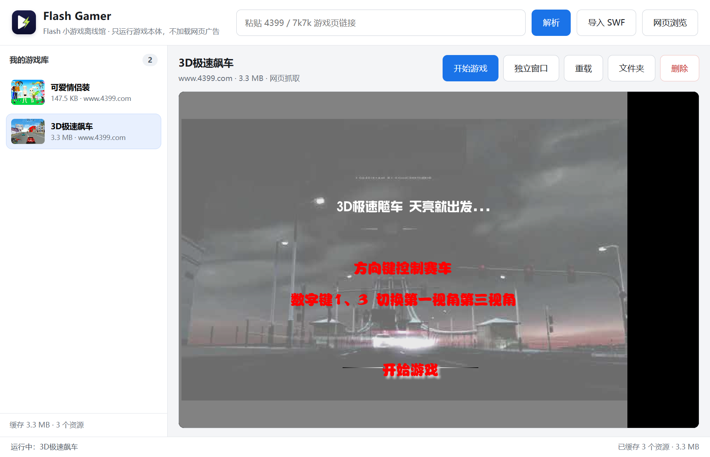

# Flash Gamer

Flash 小游戏离线馆。把Flash 游戏页面粘贴进来，取出游戏本体 SWF，存到本地，之后断网也能玩。

只运行游戏文件，不加载网页广告；不安装 Adobe Flash Player，也不带任何捆绑软件。



- 官网：<https://zsof-rui.github.io/flash-gamer/>
- 官网镜像：<https://flash-gamer-ch09cuq83vg.qoder.website/>
- 下载：<https://github.com/ZSOF-Rui/flash-gamer/releases/latest>

## 版本

| 版本 | 位置 | 内容 |
| --- | --- | --- |
| v0.3.2 | `main` 分支、GitHub Release | 网页内 Flash 播放 + 双源软件更新；NSIS 安装程序 + 免安装 zip |
| v0.3.1 | 历史版本 | 浏览器 + 登录共享 + 加壳修复；NSIS 安装程序 + 免安装 zip |
| v0.3.0 无浏览器版 | `lite` 分支 | 只保留直接粘贴链接解析；旧二进制留在本机 `release/`，未上传 Release |
| v0.2.0 | 历史提交 | 改名、新图标、独立游戏窗口、后台运行 |
| v0.1.0 | `v0.1-app-professor` 分支、`v0.1.0` 标签 | App Professor 初始版，原样保留 |

GitHub Release 只提供 v0.3.2 的安装包与免安装包；`release/` 是本机构建输出，不进入 Git 历史。

## v0.3.2 更新

- 网页浏览窗口注入 Ruffle：在 4399 游戏页里直接运行 Flash，不再依赖系统 Flash 插件。
- 4399 游戏页的「健康游戏忠告」/加载遮挡层会自动收起，游戏本体直接显示。
- 新增软件内更新：启动后自动检查，也可以点左下角「检查更新」。
- 更新源同时检查 Qoder 站点与 GitHub Pages（`flash.828696.xyz`）下的 `/updates/win-x64.json`，取版本最高的一份；下载支持多源回退。
- 更新包按清单里的 `size` 与 `sha256` 校验，校验通过后才可点「立即安装」。

## v0.3.1 更新

- 在浏览器窗口里点 4399 游戏，不再弹出一个没有地址栏的小窗；链接会在当前网页视图里打开，地址栏随之更新，仍可继续点「解析此页」。
- 输入框、地址栏支持鼠标右键：撤销、重做、剪切、复制、粘贴、全选。
- 新增 NSIS 安装程序：可选安装目录，创建桌面与开始菜单快捷方式，带标准卸载程序。
- 安装版把游戏库存到用户目录，卸载或升级不会删掉游戏；免安装版的数据跟着程序文件夹走。
- 新增静态官网与 GitHub Pages 部署工作流。

## 用法

1. 打开 Flash Gamer。
2. 把游戏页链接（例如 `https://www.4399.com/flash/10802_1.htm`）粘贴到顶部输入框，点「解析」。
3. 解析完成后游戏自动入库并开始播放；如果页面里有多个 SWF，会弹出候选列表，第一个通常就是游戏本体。
4. 之后在左侧游戏库中随时点开即可。文件保存在本机，断网也能运行。

也可以点「导入 SWF」或直接把 `.swf` 文件拖进窗口。

「独立窗口」会把当前游戏开在单独的窗口里，主窗口继续浏览、解析别的游戏都不会打断它；游戏窗口使用独立的渲染进程且关闭后台限速。

### 网页浏览

主界面点「网页浏览」打开浏览器窗口，可以像普通浏览器一样访问 4399 / 7k7k、登录账号，再点「解析此页」把当前页面的游戏收入本地库。登录 Cookie 会共享给解析器和播放器。

在网页里打开游戏链接（包括 `window.open` 弹窗）时，链接会在当前网页视图内跳转，不会另开无地址栏的小窗口。需要保留原页面时，先用游戏库或新开一个浏览器窗口。

## 安装

Windows 10 / 11 64 位。

- **安装版** `FlashGamer-0.3.2-setup.exe`：助手式安装，可改安装路径；创建桌面和开始菜单快捷方式；卸载入口在「设置 → 应用」和开始菜单。数据在 `%APPDATA%\Flash Gamer\FlashGamerData`，卸载不删除。
- **免安装版** `FlashGamer-0.3.2-portable.zip`：解压到任意文件夹，双击 `Flash Gamer.exe`。数据在 exe 同目录的 `FlashGamerData`，删文件夹即清空。

安装包没有购买代码签名证书，Windows SmartScreen 可能提示“未知发布者”，可点“更多信息 → 仍要运行”。下载页提供 SHA-256 校验值。

## 广告与捆绑

- 播放器只加载 SWF 本体，不打开游戏网页，页面上的弹窗、悬浮广告、统计脚本都不会执行。
- 抓取阶段会拦截广告与统计域名（`stat.api.4399.com`、`stat.7k7k.com`、MochiAds 等），但放行游戏前置加载器必需的 4399 控制器 SWF 与版本 XML。
- 4399 的 `cell.swf` 广告占位壳会被识别并跳过；被声明为 SWF、实际是 HTML 包装页的地址会自动跟进去取真正的 SWF。
- 部分 4399 游戏外面套了一层加载壳，真正的游戏以 `DefineBinaryData` 内嵌，并被壳用 `Loader` 载入。内层游戏会检测“是否被加壳运行”，命中就拒绝启动；本程序会把内嵌游戏抽出来（`items/<id>/play.swf`）作为顶层影片播放，壳的反加壳检查因此不成立。
- 同一个 SWF 按 SHA-256 去重，重复解析或重复导入不会产生两份文件。
- 安装包只包含 Electron、Ruffle 和本程序，没有捆绑安装器、没有浏览器主页修改、没有遥测上报。

## 技术栈

- [Electron](https://www.electronjs.org/)：桌面壳与网络抓取。
- [Ruffle](https://ruffle.rs/)：Rust 编写的开源 Flash 模拟器，运行在 WebAssembly 上，不依赖 Adobe Flash Player（使用 0.8.0 nightly 构建）。
- 本地 HTTP 服务（`localhost:43199`）：提供播放器页面、SWF 镜像与资源缓存。页面统一走 `localhost`，4399 壳才会跳过远程服务连接。

Ruffle 的兼容性覆盖大多数 Flash 8 / AS2 游戏；依赖冷门 AS3 特性的内容仍可能无法运行。

## 开发

```bash
npm install
npm start
```

`npm install` 会把 Ruffle 的 web 构建复制到 `vendor/ruffle`（也可以手动执行 `npm run vendor`）。

## 打包

```bash
npm run dist:installer   # 只出安装程序
npm run dist             # 安装程序 + 单文件便携 exe
```

NSIS 安装程序的配置在 `package.json` 的 `build.nsis` 中，`build/installer.nsh` 会在安装目录写入 `installed.marker`，程序据此把数据放到用户目录而不是安装目录。

本机打包时可指定独立输出目录，避免上一次的 `win-unpacked` 被系统短暂占用：

```bash
npx electron-builder --win nsis --x64 \
  --config.directories.output=release/build-0.3.2-dir3 --config.electronDist=release/electron-dist-45.1.0
```

免安装 zip 由打包产物的 `win-unpacked` 整理而来：

```bash
mkdir -p .tmp-pack/FlashGamer-0.3.2
cp -r release/build-0.3.2-dir3/win-unpacked/. .tmp-pack/FlashGamer-0.3.2/
rm -f .tmp-pack/FlashGamer-0.3.2/resources/default_app.asar
7z a -tzip -mx=5 release/FlashGamer-0.3.2-portable.zip .tmp-pack/FlashGamer-0.3.2
```

如果 Windows 上出现 `EPERM/EBUSY ... default_app.asar`，说明 Electron 解压后的改名被 Defender/索引服务占用，可改用已解压的 Electron 目录（`--config.electronDist=...`）。完整命令与实测记录见 [`docs/FlashGamer-实现复现.md`](docs/FlashGamer-实现复现.md)。

## 软件更新

更新清单是静态 JSON：`site/updates/win-x64.json`，随站点一起发布。软件默认同时检查：

1. `https://flash-gamer-ch09cuq83vg.qoder.website/updates/win-x64.json`（Qoder Sites）
2. `https://flash.828696.xyz/updates/win-x64.json`（GitHub Pages 自定义域名）
3. `https://zsof-rui.github.io/flash-gamer/updates/win-x64.json`（GitHub Pages 默认域名，兜底）

清单格式：

```json
{
  "version": "0.3.2",
  "publishedAt": "2026-10-31",
  "notes": "更新说明，可写多行",
  "assets": {
    "setup": { "url": "...exe", "size": 136655685, "sha256": "..." },
    "portable": { "url": "...zip", "size": 174634686, "sha256": "..." }
  }
}
```

检查与下载都在独立的 Electron session 里进行，跟随系统代理，不受应用内网页代理和 4399 请求头注入影响。多个源取最高版本；同一版本的下载按源顺序回退，流式写入磁盘后校验大小与 SHA-256，通过后才允许启动安装程序。开发时可设置 `AP_UPDATE_SOURCES` 覆盖源，`AP_UPDATE_DISABLE=1` 关闭启动自动检查。

`flash.828696.xyz` 需要在 Cloudflare 添加 CNAME 记录指向 `zsof-rui.github.io`，并在 GitHub Pages 设置里把该仓库的 Custom domain 填成 `flash.828696.xyz`；在 DNS 生效前这一路检查会失败，不影响其他源。

## 官网

`site/` 是纯静态站点（无构建步骤），推送到 `main` 后由 [`.github/workflows/pages.yml`](.github/workflows/pages.yml) 发布到 GitHub Pages。`site/dist/` 是同一份站点内容（含 `updates/` 清单）的部署副本，用于 Qoder Sites。

本地预览时用任意静态服务器指向 `site/` 即可。

## 数据位置

- 开发模式：`data/`
- 安装版：`%APPDATA%\Flash Gamer\FlashGamerData\`
- 免安装版：exe 同目录的 `FlashGamerData/`；目录只读时退回用户目录
- 首次运行会尝试从旧的 `AppProfessorData/` 迁移游戏库

删除对应目录即可清空游戏库与缓存。
