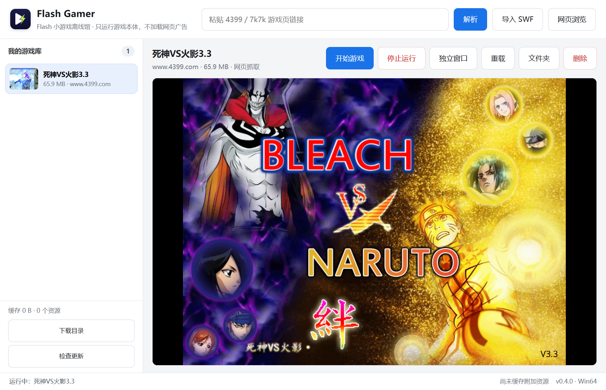

# Flash Gamer

Flash 小游戏离线馆。把 Flash 游戏页面粘贴进来，取出游戏本体 SWF，存到本地，之后断网也能玩。

只运行游戏文件，不加载网页广告；不安装 Adobe Flash Player，也不带任何捆绑软件。

支持 Windows 32 / 64 位与 macOS Intel / Apple 芯片，源码以 [CC BY-NC 4.0](LICENSE) 许可开放。



- 官网：<https://flash.828696.xyz/>
- 官网镜像：<https://flash-gamer-ch09cuq83vg.qoder.website/>
- 下载：<https://github.com/ZSOF-Rui/flash-gamer/releases/latest>

## 版本

| 版本 | 位置 | 内容 |
| --- | --- | --- |
| v0.4.0 | `main` 分支、GitHub Release | 四平台构建、自定义下载目录、按平台更新；Windows 32/64 位 + macOS Intel/ARM |
| v0.3.3 | 历史版本 | 停止运行、圆角应用图标；NSIS 安装程序 + 免安装 zip |
| v0.3.2 | 历史版本 | 网页内 Flash 播放 + 双源软件更新；NSIS 安装程序 + 免安装 zip |
| v0.3.1 | 历史版本 | 浏览器 + 登录共享 + 加壳修复；NSIS 安装程序 + 免安装 zip |
| v0.3.0 无浏览器版 | `lite` 分支 | 只保留直接粘贴链接解析；旧二进制留在本机 `release/`，未上传 Release |
| v0.2.0 | 历史提交 | 改名、新图标、独立游戏窗口、后台运行 |
| v0.1.0 | `v0.1-app-professor` 分支、`v0.1.0` 标签 | App Professor 初始版，原样保留 |

## 用法

1. 打开 Flash Gamer。
2. 把游戏页链接（例如 `https://www.4399.com/flash/10802_1.htm`）粘贴到顶部输入框，点「解析」。
3. 解析完成后游戏自动入库并开始播放；如果页面里有多个 SWF，会弹出候选列表，第一个通常就是游戏本体。
4. 之后在左侧游戏库中随时点开即可。文件保存在本机，断网也能运行。

也可以点「导入 SWF」或直接把 `.swf` 文件拖进窗口。

游戏文件默认保存在应用数据目录。点左下角「下载目录」可以换成任意可写文件夹，并可选择把现有游戏一起复制过去；保存后程序自动重启生效。目标目录里如果已有 `library.json`，程序会先确认再使用。

「独立窗口」会把当前游戏开在单独的窗口里，主窗口继续浏览、解析别的游戏都不会打断它；游戏窗口使用独立的渲染进程且关闭后台限速。

点「停止运行」会卸载主窗口里的播放器，并关闭所有独立游戏窗口；之后点「开始游戏」可以重新启动。

### 网页浏览

主界面点「网页浏览」打开浏览器窗口，可以像普通浏览器一样访问 4399 / 7k7k、登录账号，再点「解析此页」把当前页面的游戏收入本地库。登录 Cookie 会共享给解析器和播放器。

在网页里打开游戏链接（包括 `window.open` 弹窗）时，链接会在当前网页视图内跳转，不会另开无地址栏的小窗口。需要保留原页面时，先用游戏库或新开一个浏览器窗口。

## 安装

Windows 10 / 11（32 / 64 位）与 macOS 12 及以上（Intel / Apple 芯片）。安装包与 zip 都按平台分开，文件名中的 `win-x64`、`win-ia32`、`mac-arm64`、`mac-x64` 对应 CPU 架构。

Windows：

- **安装版** `FlashGamer-<版本>-win-<架构>-setup.exe`：助手式安装，可改安装路径；创建桌面和开始菜单快捷方式；卸载入口在「设置 → 应用」和开始菜单。安装版数据在 `%APPDATA%\Flash Gamer\FlashGamerData`，卸载不删除。
- **免安装版** `FlashGamer-<版本>-win-<架构>.zip`：解压到任意文件夹，双击 `Flash Gamer.exe`。数据在 exe 同目录的 `FlashGamerData`，删文件夹即清空；目录只读时退回用户目录。
- 32 位 Windows 选 `win-ia32`，64 位选 `win-x64`。

macOS：

- Apple 芯片（M1 及以上）选 `mac-arm64`，Intel Mac 选 `mac-x64`；每个平台都提供 `.dmg` 和 `.zip`。
- 打开 DMG 后把 `Flash Gamer.app` 拖进「应用程序」。zip 解压后直接双击 app。
- 应用未签名、未公证，首次打开若提示“无法验证开发者”，在 Finder 中右键 app →「打开」，或执行 `xattr -dr com.apple.quarantine "/Applications/Flash Gamer.app"`。
- macOS 数据固定在 `~/Library/Application Support/Flash Gamer/FlashGamerData`；自定义下载目录仍然可用。

安装包没有购买代码签名证书，Windows SmartScreen 也可能提示“未知发布者”，可点“更多信息 → 仍要运行”。下载页提供每个文件的 SHA-256 校验值。

## 广告与捆绑

- 播放器只加载 SWF 本体，不打开游戏网页，页面上的弹窗、悬浮广告、统计脚本都不会执行。
- 抓取阶段会拦截广告与统计域名（`stat.api.4399.com`、`stat.7k7k.com`、MochiAds 等），但放行游戏前置加载器必需的 4399 控制器 SWF 与版本 XML。
- 4399 的 `cell.swf` 广告占位壳会被识别并跳过；被声明为 SWF、实际是 HTML 包装页的地址会自动跟进去取真正的 SWF。
- 部分 4399 游戏外面套了一层加载壳，真正的游戏以 `DefineBinaryData` 内嵌，并被壳用 `Loader` 载入。内层游戏会检测“是否被加壳运行”，命中就拒绝启动；本程序会把内嵌游戏抽出来（`items/<id>/play.swf`）作为顶层影片播放，壳的反加壳检查因此不成立。
- 同一个 SWF 按 SHA-256 去重，重复解析或重复导入不会产生两份文件。
- 安装包只包含 Electron、Ruffle 和本程序，没有捆绑安装器、没有浏览器主页修改、没有遥测上报。

## 技术栈

- [Electron](https://www.electronjs.org/)：桌面壳与网络抓取。固定在 43.x，因为 Electron 从 44 起不再发布 Windows 32 位二进制；43.x 仍同时提供 Windows x64 / ia32 与 macOS x64 / arm64。
- [Ruffle](https://ruffle.rs/)：Rust 编写的开源 Flash 模拟器，运行在 WebAssembly 上，不依赖 Adobe Flash Player（使用 0.8.0 nightly 构建）。
- 本地 HTTP 服务（`localhost:43199`）：提供播放器页面、SWF 镜像与资源缓存。页面统一走 `localhost`，4399 壳才会跳过远程服务连接。

Ruffle 的兼容性覆盖大多数 Flash 8 / AS2 游戏；依赖冷门 AS3 特性的内容仍可能无法运行。

## 开发

```bash
npm install
npm start
```

`npm install` 会把 Ruffle 的 web 构建复制到 `vendor/ruffle`（也可以手动执行 `npm run vendor`）。

## 打包

对外发布的四个平台产物全部由 GitHub Actions 构建；下面的本机命令只用于开发调试，不作为发布产物：

```bash
npm install
npm run dist:win   # Windows：NSIS 安装程序 + zip，x64 与 ia32
npm run dist:mac   # macOS：DMG + zip，x64 与 arm64
npm run dist       # 等同 dist:win
```

产物写在 `release/`，命名规则为 `FlashGamer-<版本>-<win|mac>-<x64|ia32|arm64>[-setup].<exe|zip|dmg>`。NSIS 配置在 `package.json` 的 `build.nsis`，`build/installer.nsh` 会在安装目录写入 `installed.marker`，程序据此把数据放到用户目录而不是安装目录。macOS 图标由 `npm run icns` 从 `build/icons/` 的 PNG 生成。

本机重复打包时可指定独立输出目录，避免上一次的 `win-unpacked` 被系统短暂占用：

```bash
npx electron-builder --win nsis zip --x64 --ia32 \
  --config.directories.output=release/build-0.4.0-dir
```

### 自动构建

[`.github/workflows/build.yml`](.github/workflows/build.yml) 在推送 `v*` 标签或手动运行时：

1. `windows-latest` 构建 x64 / ia32 的 NSIS 与 zip；
2. `macos-latest` 构建 x64 / arm64 的 DMG 与 zip；
3. 汇总全部产物，运行 `scripts/make-update-manifests.js` 生成四个更新清单；
4. 创建或更新对应标签的 GitHub Release，并把站点（`index.html`、`download.html`、`assets/`、`updates/`）部署到 GitHub Pages。

发布流程不在本机编译或上传二进制；需要重跑时，在 Actions 里手动运行 `Build and release` 并填入 tag 即可。

构建未签名产物，不需要证书 Secrets；macOS 的 `identity` 已关闭。日常的依赖升级由 [`.github/dependabot.yml`](.github/dependabot.yml) 每周检查 npm 与 GitHub Actions。

## 软件更新

更新清单按平台分成四份：`site/updates/win-x64.json`、`win-ia32.json`、`mac-x64.json`、`mac-arm64.json`，随站点一起发布。软件根据当前系统和 CPU 架构选择对应清单。每份清单默认同时检查：

1. `https://flash-gamer-ch09cuq83vg.qoder.website/updates/<channel>.json`（Qoder Sites）
2. `https://flash.828696.xyz/updates/<channel>.json`（GitHub Pages 自定义域名）
3. `https://zsof-rui.github.io/flash-gamer/updates/<channel>.json`（GitHub Pages 默认域名，兜底）

清单格式（Windows 用 `setup` / `portable`，macOS 用 `dmg` / `zip`）：

```json
{
  "version": "0.4.0",
  "publishedAt": "2026-11-05",
  "notes": "更新说明，可写多行",
  "assets": {
    "setup": { "url": "...setup.exe", "size": 136394562, "sha256": "..." },
    "portable": { "url": "...win-x64.zip", "size": 174650223, "sha256": "..." }
  }
}
```

检查与下载都在独立的 Electron session 里进行，跟随系统代理，不受应用内网页代理和 4399 请求头注入影响。多个源取最高版本；同一版本的下载按源顺序回退，流式写入磁盘并校验大小与 SHA-256，通过后才允许安装。Windows 会启动安装程序并在安装器接管后退出；macOS 的 DMG 会直接打开，zip 会定位到 Finder，由用户拖入「应用程序」。

开发时可设置 `AP_UPDATE_SOURCES`（用空格或逗号分隔）覆盖清单地址，`AP_UPDATE_DISABLE=1` 关闭启动自动检查。

`flash.828696.xyz` 需要在 Cloudflare 添加 CNAME 记录指向 `zsof-rui.github.io`，并在 GitHub Pages 设置里把该仓库的 Custom domain 填成 `flash.828696.xyz`；在 DNS 生效前这一路检查会失败，不影响其他源。

## 官网

`site/` 是纯静态站点（无构建步骤）：首页介绍功能，`download.html` 负责按平台选择安装版或免安装包。推送到 `main` 后由 [`.github/workflows/pages.yml`](.github/workflows/pages.yml) 只把这几个公开文件发布到 GitHub Pages；发布 `v*` 标签时 `build.yml` 会先生成更新清单再部署一次。`site/dist/` 是同一份站点内容（含 `updates/` 清单）的部署副本，用于 Qoder Sites。

下载页会读取 `updates/<channel>.json` 自动填充版本、文件名、大小与 SHA-256；清单读取失败时保留页面里的静态兜底文案。本地预览时用任意静态服务器指向 `site/` 即可。

## 数据位置

- 开发模式：`data/`
- 安装版：`%APPDATA%\Flash Gamer\FlashGamerData\`
- 免安装版：exe 同目录的 `FlashGamerData/`；目录只读时退回用户目录
- macOS：`~/Library/Application Support/Flash Gamer/FlashGamerData/`
- 自定义下载目录：设置保存在默认数据目录的 `settings.json`，游戏文件存到用户选择的文件夹

首次运行会尝试从旧的 `AppProfessorData/` 迁移游戏库。删除默认数据目录即可清空游戏库、设置与缓存；如果设置过自定义下载目录，还需要删除对应文件夹。

## 许可证

源码、站点与文档以 [Creative Commons Attribution-NonCommercial 4.0 International（CC BY-NC 4.0）](LICENSE) 发布：允许非商业性使用、修改与再分发，需保留署名和许可声明，不得用于商业目的。

Electron、Ruffle 等第三方组件仍遵循各自的开源许可证。
