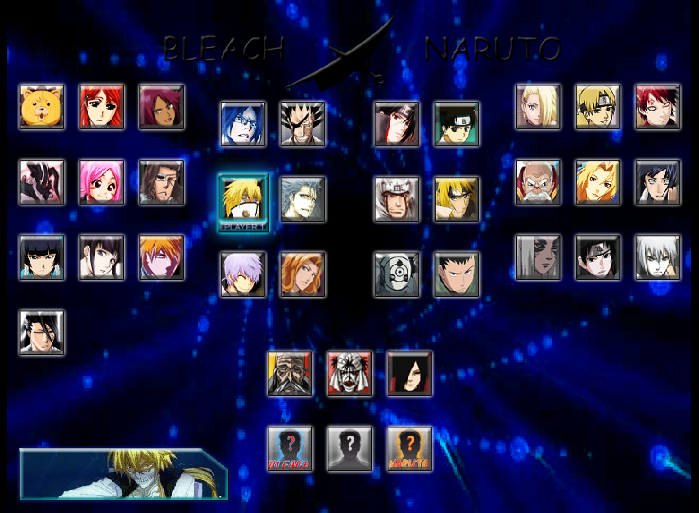
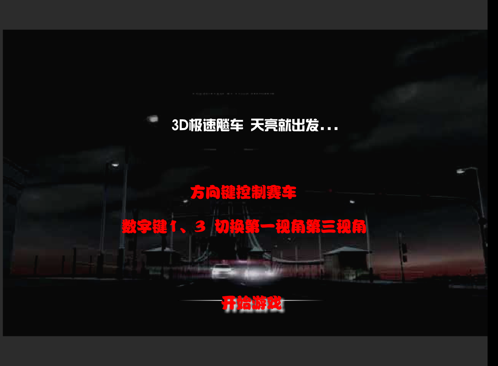
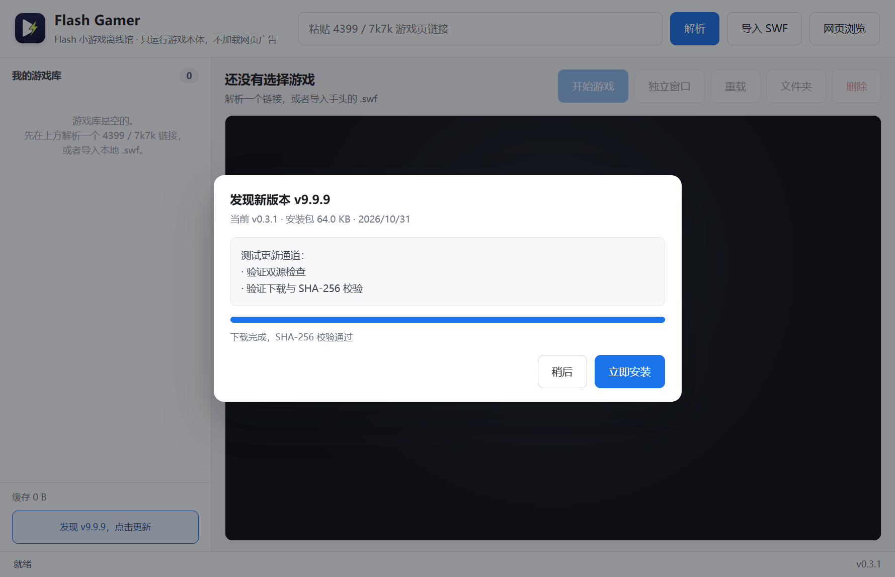

# Flash Gamer 实现复现手册（v0.3.2）

本文按“需求 → 结论 → 实现 → 复现命令 → 验证证据 → 限制”的顺序记录本项目的全部改动。  
目标读者是拿到源码后想把每一处行为重新做出来、或想定位某个游戏为什么不能玩的人。

---

## 1. 需求清单与验收标准

| 编号 | 需求（用户原话） | 验收标准 |
| --- | --- | --- |
| R1 | 应用名改成 Flash Gamer | 窗口标题、程序名、安装包名、开始菜单名、数据目录名均为 Flash Gamer |
| R2 | 重新设计 logo | 新图标出现在 exe、窗口、主界面左上角；旧 AP 图标不再出现 |
| R3 | 加入网页功能，有的游戏要网页在线登录，有的网站要在线浏览 | 独立浏览器窗口可打开任意 http/https 页面；登录后 Cookie 能被游戏请求复用 |
| R4 | 4399 还是有部分加入库失效 | 40779 能解析并游玩；205551 不再报 `allowScriptAccess`，且能穿过壳的反加壳检查进入游戏 |
| R5 | 后台运行游戏不被其他操作打断 | 游戏可开在独立窗口，主窗口继续解析/浏览，游戏不降频、不暂停 |
| R6 | 大量游戏同时加载出来两个文件但是一个都没用，做个问题确定一下 | 找出“两个候选都无效”的根因并修掉；重复解析不再产生重复条目 |
| R7 | 新版本放 dev 分支，没有浏览器功能的放本分支，不覆盖旧版/第一版 | `main`=v0.2 无浏览器；`dev`=v0.3 带浏览器；v0.1 产物原样保留 |
| R8 | 不行的功能就用 REA 逆向 | 对 4399 加载壳做二进制字符串提取、网络抓包与 Ruffle 内部行为验证 |
| R9 | 把需求和所有功能具体实现思路复现 | 本文档 |
| R10 | 完成之后关机 | 全部产物验证完毕后执行关机 |
| R11 | 网页浏览时没法正常调用 Flash | 在网页浏览窗口打开 4399 游戏页，Flash 由内置 Ruffle 直接运行，不再要求系统 Flash 插件 |
| R12 | 软件加入更新功能，更新源同时检测站点域名与 `flash.828696.xyz` 同目录 | 两个源并发检查，取最高版本；下载校验 SHA-256；任一源可用即可更新 |
| R13 | 网站先用站点功能部署，解决后 GitHub 仓库名改为软件名 | Qoder Sites 与 GitHub Pages 都发布同一份站点；仓库名 `flash-gamer` 与软件名一致 |

---

## 2. 版本与分支

```
main    Flash Gamer v0.3.2（网页内 Flash + 双源更新 + 安装程序 / 官网）
dev     开发分支（v0.3.1 起与 main 同步，后续实验在此进行）
lite    Flash Gamer v0.3.0（无浏览器，含 4399 加壳修复；旧 main 原样保留）
v0.1.0  c773483  App Professor v0.1.0（只读归档）
```

历史版本 v0.2.0（原 main 的 e2208c6）与 v0.3.0-dev（dev 的 ca0c608）的产物原样保留，不覆盖。v0.3.0 无浏览器版从 `main` 移到 `lite` 分支，`main` 从 v0.3.1 起承载带浏览器、安装程序和官网的正式版；v0.3.2 在此基础上加入网页内 Flash 与双源更新。

- v0.1 的源码快照取自 `release/AppProfessor/resources/app`，单独提交在 `v0.1-app-professor` 分支并打 `v0.1.0` 标签。
- **v0.1 的任何运行产物都没有被覆盖**：
  - `release/AppProfessor/`
  - `release/AppProfessor-0.1.0-portable.zip`（sha256 不变）
- 每次打包使用独立的临时目录（v0.3.2 为 `release/build-0.3.2-dir3`），最后整理成 `release/FlashGamer-<version>/` 及对应 zip；历史版本的目录与 zip 保持不变。

---

## 3. 总体架构

```
┌────────────────────────── Electron 主进程 (src/main.js) ──────────────────────────┐
│  窗口管理：主窗口 / 独立游戏窗口 / 浏览器窗口(dev)                                  │
│  解析流程：Inspector（隐藏窗口抓包）→ 候选排序 → 下载校验 → 入库                     │
│  网络层：onBeforeRequest(广告拦截/控制器重定向)                                     │
│          onBeforeSendHeaders(Referer/登录 Cookie)                                  │
│          onHeadersReceived(CORS，仅播放器上下文)                                    │
└───────────────┬───────────────────────────────────────────────────────────────────┘
                │ IPC (preload.js / browser-preload.js)
┌───────────────▼────────────┐    ┌──────────────────────────────────────────────┐
│ 渲染层 renderer/            │    │ 本地 HTTP 服务 localhost:PORT (src/lib/server.js)  │
│  index.html  主界面         │    │  /            主界面（ap_session Cookie 鉴权）     │
│  player.html 播放页         │    │  /play/:id    播放页（Ruffle 启动参数注入）        │
│  browser.html 浏览窗口(dev) │    │  /m/:id/...   SWF 镜像代理 + 资源缓存             │
└────────────────────────────┘    │  /file/:id/   本地 SWF                            │
                                  │  /vendor/ruffle、/vendor/4399、/cover            │
                                  └──────────────────────────────────────────────┘
```

数据目录（安装版为 `%APPDATA%\Flash Gamer\FlashGamerData/`，免安装版为 exe 同目录 `FlashGamerData/`）：

```
FlashGamerData/
  library.json            游戏条目（含 sha256、flashvars、referer、cookie）
  items/<id>/
    main.swf              游戏本体（原始抓取结果）
    play.swf              加壳游戏抽出的内层 SWF；存在时优先播放
    cover.jpg             封面
    cache/<sha1>          运行时抓到的附加资源（含 .meta.json）
  tmp/                    Inspector 临时下载目录
  config.json             端口
```

---

## 4. 逐项实现

### 4.1 改名（R1）与图标（R2）

改动点：

- `package.json`：`name=flash-gamer`、`version=0.2.0`、`build.appId=com.flashgamer.desktop`、`build.productName=Flash Gamer`、`portable.artifactName=FlashGamer-${version}-portable.exe`。
- `src/main.js`：`app.setName('Flash Gamer')`；窗口 `title`、`icon` 更新；便携版数据目录 `FlashGamerData`，首次运行若存在旧 `AppProfessorData` 且新目录无 `library.json`，用 `fs.cpSync` 迁移。
- `src/renderer/index.html`：标题、品牌名、``。
- `src/renderer/player.html`：`<title>Flash Gamer</title>`，加载后按游戏标题设置 `document.title`。
- `README.md` 重写。

图标生成（可复现）：

```bash
# 1) 生成 1024×1024 源图（本仓库直接使用 vibe_images/flash-gamer-icon_*.png）
# 2) 安装纯 JS 工具到临时目录，避免污染依赖
npm install --prefix .tmp-tools jimp png-to-ico
# 3) 缩放并打包 ICO（16/32/48/64/128/256 多尺寸，512 供界面用）
node .tmp-make-icon.js vibe_images/flash-gamer-icon_1793385242463_3d79eefa.png
# 产物：build/icon.ico、build/icons/icon-*.png、src/renderer/icon.png
```

`png-to-ico` 生成的是 PNG 负载 ICO（Vista+ 支持），electron-builder 直接接受。

### 4.2 独立游戏窗口与后台运行（R5）

两个问题需要一起解决：

1. **渲染节流**：Chromium 会把不可见/被遮挡窗口的定时器降到 1Hz，游戏会“像卡住”。
2. **窗口绑定**：游戏直接嵌在主窗口 iframe 里，主窗口重载/切页就会重新加载游戏。

实现：

```js
// src/main.js 启动最前面
app.commandLine.appendSwitch('disable-renderer-backgrounding');
app.commandLine.appendSwitch('disable-background-timer-throttling');
app.commandLine.appendSwitch('disable-backgrounding-occluded-windows');

// 所有游戏相关窗口
webPreferences: { backgroundThrottling: false }
```

```js
// openGameWindow(id)：单实例、同 session、加载 /play/:id
const win = new BrowserWindow({
  width: 1000, height: 760, backgroundColor: '#000000',
  title: item.title, icon: .../icon.png,
  webPreferences: { contextIsolation: true, sandbox: true, backgroundThrottling: false }
});
win.loadURL(`${srv.origin}/play/${id}`);
```

- 主窗口点「独立窗口」→ `window.api.openWindow(id)` → `library:openWindow` IPC。
- 同一个游戏重复点击只会聚焦已开的窗口（`gameWindows` Map 按 id 去重）。
- 独立窗口共享 `session.defaultSession`，所以 `/play` 的 `ap_session` Cookie 直接可用。
- 主窗口最小化、刷新、解析别的游戏都不影响游戏窗口；游戏窗口关闭时才 `gameWindows.delete(id)`。

### 4.3 4399 解析失败修复（R4 / R6）

#### 4.3.1 40779：声明的是 HTML 包装页

现象：`https://www.4399.com/flash/40779_3.htm` 解析出的唯一候选是 `cell.swf`（3,643 字节广告占位壳），保存后黑屏。

逆向过程：

1. 抓页面源码 → 页面声明的 SWF 地址是 `.../9/Pack_jifen3_https.htm`（GB2312 编码的 HTML 文件）；
2. 下载该 HTML → 里面是 `<object><param name="movie" value="main.swf">`；
3. 真正游戏是同级目录的 `main.swf`（3,474,287 字节）；
4. `cell.swf` 是 4399 统一的广告/占位嵌入文件，所有页面都会出现。

修复（`src/lib/inspector.js`）：

```js
function looksHtml(buf, contentType) { /* text/html 或 <!doctype/<html 开头 */ }
function swfRefsFromHtml(text, baseUrl) {
  // 从 src/value/movie/data/url/file 属性、引号字符串、绝对 URL 中提取 .swf
}
function isAdSwf(url) {
  return /(^|\.)4399\.com$/i.test(host) && /\/flash\/cell\.swf$/i.test(path);
}
```

- 候选入队时直接丢弃 `cell.swf`；
- 下载阶段发现内容是 HTML 时，不报错，改为解析出其中的 SWF 引用，用包装页的 URL 作为 Referer 再下一轮下载；
- 第二轮结果优先级设为 4（高于普通声明候选），并合并去重。

验证：候选只剩 `main.swf`，`via=wrapper`，进入游戏后显示标题页「3D极速飙车 天亮就出发…」。

#### 4.3.2 205551：三层拦截，逐层拆解

现象按排查顺序出现过三种：

1. 直接播放抓到的 `main.swf`（69 MB CWS）时，画面只显示「• allowScriptAcc…」；
2. 补上 flashvars 后报错消失，但停在 4399 加载页，日志出现 `real size: 69431196`；
3. 反编译后确认：外层是加载壳，真实游戏以 `DefineBinaryData` 内嵌，外层用 `Loader` 载入；内嵌游戏自带同一套 4399 壳代码，检测到 `loaderInfo.loader != null` 且页面不在 4399 域，弹出「不允许加壳运行 / No running in a loader.」并中止。

##### 第一层：播放器参数校验

逆向过程（REA）：

1. 解压 SWF（CWS/zlib）后搜索字符串，找到壳内置语言表：
   ```xml
   <allowScriptAccess en="Permission of 'allowScriptAccess' is required."
                       zh-CN="本文件要求allowScriptAccess权限"/>
   ```
2. 同一段 ABC 常量池里有壳的参数表：
   ```
   params: { allowScriptAccess: "always", allowNetworking: "all", recParams: { allowFullScreen: true } }
   com.sh.m_sh_manager / com.green.net.text_bin_loader / swf_loader / BleachVSNaruto_3_3
   ```
   说明壳读取的是 **`loaderInfo.parameters`（flashvars）**，而不是 `<param name="allowScriptAccess">` 嵌入属性。
3. 壳还会通过 ExternalInterface 找到播放器元素，按 `nodeName` 区分 OBJECT/EMBED，再用 `getAttribute` 读 `allowScriptAccess`/`allowNetworking` 与参数表比对；不匹配就 `dispose()`，并用字符串 `setTimeout` 执行 `fl_obj.cloneNode()` + `replaceChild` 重新挂载播放器。
4. Ruffle 的 `allowScriptAccess` 配置只影响 `ExternalInterface.available()`，不会写入 `loaderInfo.parameters`，`<ruffle-player>` 也没有这些属性。
5. 对比网络日志，壳还会请求：
   - `https://cdn.comment.4399pk.com/control/ctrl_mo_v5.swf`（4399 控制器）
   - `https://cdn.comment.4399pk.com/control/A4399dv_base.swf`
   - `https://stat.api.4399.com/flash_ctrl_version.xml`、`flash_ad_version.xml`
   这些被广告域名黑名单全部拦掉，壳停在加载阶段。

修复：

```js
// src/lib/server.js
const DEFAULT_FLASHVARS = {
  allowScriptAccess: 'always',
  allowNetworking: 'all',
  allowFullScreen: 'true'
};
function mergeFlashvars(item) { return { ...DEFAULT_FLASHVARS, ...(item.flashvars || {}) }; }
// buildBoot 的两个分支都改为 parameters: mergeFlashvars(item)
```

```js
// src/renderer/player.html：把 <ruffle-player> 伪装成带参数的 EMBED
player.id = 'flashgame';
player.setAttribute('name', 'flashgame');
player.setAttribute('type', 'application/x-shockwave-flash');
player.setAttribute('allowScriptAccess', 'always');
player.setAttribute('allowNetworking', 'all');
player.setAttribute('allowFullScreen', 'true');
Object.defineProperty(player, 'nodeName', { get: () => 'EMBED', configurable: true });
Object.defineProperty(player, 'tagName', { get: () => 'EMBED', configurable: true });
```

```js
// 壳的克隆替换脚本一旦执行，<ruffle-player> 被换掉后不会再初始化，直接拦截
var nativeTimeout = window.setTimeout;
window.setTimeout = function (fn, ms) {
  if (typeof fn === 'string' && fn.indexOf('fl_obj') !== -1 && fn.indexOf('cloneNode') !== -1) return 0;
  return nativeTimeout.apply(this, arguments);
};
```

- CSP 必须保留 `'unsafe-eval'`（`ExternalInterface.addCallback` 用 `eval` 注册回调），`/play` 页的 nonce CSP 也保留。
- 本地页面必须用 `localhost` 而不是 `127.0.0.1`：壳用 `location.hostname` 判断 4399 域，只有 localhost 会跳过 `start_remote()`；`127.0.0.1` 会尝试连 4399 远程服务。
- CORS 注入跳过本地地址的规则同步覆盖 `localhost`，与 `127.0.0.1` 一致。

```js
// src/lib/blocklist.js：按 URL 放行加载器必需资源，域名仍保持黑名单
const PRELOADER_ALLOW = [
  /^https?:\/\/cdn\.comment\.4399pk\.com\/control\/[\w.-]+\.swf$/i,
  /^https?:\/\/cdn\.comment\.4399pk\.com\/control\/zwsf2-3\.gif$/i,
  /^https?:\/\/stat\.api\.4399\.com\/flash_(?:ctrl|ad)_version\.xml$/i
];
```

```js
// src/main.js：把 ctrl_mo_v5.swf 重定向到本地副本，避开 4399 CDN 的防盗链
if (u.hostname === 'cdn.comment.4399pk.com' && /\/control\/ctrl_mo_v5\.swf$/i.test(u.pathname)) {
  return callback({ redirectURL: `http://127.0.0.1:${srv.port}/vendor/4399/ctrl_mo_v5.swf` });
}
```

`vendor/4399/ctrl_mo_v5.swf`（415,361 字节）随包分发；`/vendor/4399/*` 路由免 `ap_session` 鉴权并返回 `Access-Control-Allow-Origin: *`（Ruffle 以 fetch 方式拉取）。

##### 第二层：反加壳检测

第一层修好后，壳能走完全部初始化，但内层游戏一启动就调用 `showError`。REA 定位到判定链：

- `ɕ.ȑ`（加载完成回调）中检查 `ǵ.ɐ.Ʌ && !FB.serviceHold["ˢ"] && serviceHold.isReady`；
- `ǵ.ɐ.Ʌ` 就是 `loaderInfo.loader`（当前影片是被谁加载的）；
- `ˢ` 来自 `com.sh.Ǽ` 的 4399 主机名白名单，`localhost`/`127.0.0.1` 不在内；
- 条件成立即调用 `AlertUI` 显示「不允许加壳运行」/「No running in a loader.」并中止；
- 同一段代码打印的 `real size: 69431196` 取自 `loaderInfo.bytes.length`，说明外层通过 `Loader` 载入的确实是 69,431,196 字节的内层 SWF。

`LoaderProbe` 实验确认：顶层播放时 `loaderInfo.loader` 为 null，只有被 `Loader` 载入时才非空。因此改参数绕不过去，必须改变“谁在顶层播放”。

##### 第三层：抽出内嵌 SWF 顶播

205551 的外层壳把真实游戏以 tag 87（`DefineBinaryData`）内嵌在文件里。写一个最小 SWF 解析器，把内层游戏抽出来作为顶层影片播放，反加壳条件自然不成立：

```js
// src/lib/swf-embed.js（节选）
function inflateBody(buf) {
  if (buf.subarray(0, 3).toString('latin1') === 'FWS') return buf.subarray(8);
  if (buf.subarray(0, 3).toString('latin1') === 'CWS') return zlib.inflateSync(buf.subarray(8));
  return null;
}
function largestEmbeddedSwf(body) {
  // 跳过 RECT，遍历标签；code 87 且长度 > 1 MiB，取最大的一段
  // 校验内嵌数据以 FWS/CWS/ZWS 开头、声明长度与实际相符
}
function extractInnerSwf(buf) {
  const body = inflateBody(buf);
  // 只处理带 "No running in a loader" 标记的壳，避免误伤普通 SWF
  if (!body || !body.includes(ANTI_LOADER_MARK)) return null;
  return largestEmbeddedSwf(body);
}
```

服务端在进入播放页前抽取一次并缓存：

```js
// src/lib/server.js
await ensureInnerSwf(item);          // /play/:id 之前
// 抽取结果写入 items/<id>/play.swf，存在且 > 1 MiB 即复用
// 主 SWF 请求（/m 代理按 origin+pathname 匹配 originalUrl，以及 /file/<id>/main.swf）
// 命中时改为返回 play.swf
```

- 抽取幂等：`play.swf` 已存在就不再解析 69 MB 的主文件；
- 只有带反加壳标记的壳才抽取；40779 的普通 SWF 与已抽取的内层游戏都返回 `null`，不会误伤；
- 内层游戏作为顶层影片运行，`loaderInfo.loader` 为 null，反加壳检查通过。

结果与复现验证：

- 「allowScriptAccess」报错消失，也没有 Ruffle 的 `Loader.load() addChild` stub 阻塞；
- 205551 进入标题页与选人界面（`docs/FlashGamer-v0.3.0-205551.png`），打包版首启自动抽取 `play.swf` 69,431,196 B；
- 40779（`docs/FlashGamer-v0.3.0-40779.png`）与既有游戏回归正常；
- 旧版文档把黑屏归因于 Ruffle Loader stub，该结论已废弃：真正原因是内层游戏的 4399 反加壳检查。

#### 4.3.4 “两个文件但一个都没用”的判定（R6）

结论：不是队列并发 bug，而是**候选本身无效**：

- 候选 1：`cell.swf` —— 4399 广告占位壳，任何页面都会出现，体积小；
- 候选 2：声明地址实际是 `.htm` 包装页，下载后不是 SWF（旧逻辑保存失败或保存成一个“不能用”的文件）。

修复后：

- `cell.swf` 在候选阶段跳过；
- `.htm` 包装页自动跟进取真 SWF；
- 候选按 URL 去重（`seen` 集合），入库按 `sha256` 去重：重复解析/导入同一个 SWF 直接返回已有条目，不再产生第二份文件。

验证：对同一个链接连续解析两次，`library.json` 条目数保持 1。

### 4.4 网页浏览与登录（R3，dev 分支）

窗口结构：

- 独立 `BrowserWindow`，加载本地 `/browser`（`src/renderer/browser.html`）；
- 页面内 `<webview id="view">` 承载任意网站，`webviewTag: true` 仅对浏览器窗口开放；
- 工具栏：后退 / 前进 / 刷新 / 地址栏 / 打开 / 解析此页；
- 地址栏输入无协议时补 `https://`，非 URL 文本走 Bing 搜索；
- 默认打开 `https://www.4399.com/`，上次访问地址存 `localStorage`。

登录共享的两条路径：

1. **请求头注入**（`src/main.js` `onBeforeSendHeaders`，仅播放器上下文）：
   ```js
   const cks = await session.defaultSession.cookies.get({ url: details.url });
   if (cks.length) headers.Cookie = cks.map(c => `${c.name}=${c.value}`).join('; ');
   ```
   Ruffle 的 fetch 从 `127.0.0.1` 页面发往游戏 CDN 时，原本不会带第三方 Cookie；这里按目标 URL 从会话 Cookie 罐取值补上。
2. **服务端代理注入**（`src/lib/server.js` `cookieProvider`）：
   ```js
   // 代理 /m/ 与 CONNECT 转发时，优先用当前会话 Cookie，否则回退到条目里解析时保存的 Cookie
   const cookie = await resolveCookie(targetUrl, item);
   ```
   这样即使资源走本地 HTTP 代理，也能带上登录态。

上下文隔离：

- `isPlayerContext(details)` 只对主窗口（含播放 iframe）与独立游戏窗口生效；
- Referer/Cookie/CORS 注入都加了这个判断，浏览窗口的普通网页不会被塞入游戏的 Referer，也不会被强行加 CORS 头。

“解析此页”：

```js
// 浏览器窗口 IPC
const res = await inspectPage({ pageUrl, tmpDir: TMP_DIR, onProgress });
const item = await buildItemFromCandidate({ session: res, candidate: res.candidates[0] });
mainWindow.webContents.send('library:changed');   // 主窗口刷新列表
```

验证截图：浏览器窗口打开 4399 的 40779 页面，弹出「先登录，再游戏」登录框；点「解析此页」后提示「已加入游戏库：3D极速飙车（3.3 MB，共 1 个候选）」。

### 4.5 Ruffle 升级

- 版本：`0.8.0-nightly.2026.10.29`（npm dist-tag `nightly`）。
- `scripts/vendor-ruffle.js` 会把 `node_modules/@ruffle-rs/ruffle` 下的 `ruffle.js` 与 `*.wasm` 复制到 `vendor/ruffle`；新版是自包含布局（`ruffle_web_bg.*.wasm`、`ruffle_web-wasm_mvp_bg.*.wasm`），旧的 `core.ruffle.*` 文件需要先清理。
- 打包 `files` 从 `vendor/ruffle/**/*` 改为 `vendor/**/*`，确保 `vendor/4399` 一起进包。

---

## 5. 从零复现

### 5.1 环境

- Windows 10/11 x64，Node.js ≥ 20（本机 v24.18.0）
- 网络可访问 npm 与 4399；无 GitHub 依赖（Ruffle 走 npm）
- Git Bash 下注意：如果设置了 `ELECTRON_RUN_AS_NODE=1`，启动 Electron 前必须 `unset ELECTRON_RUN_AS_NODE NODE_OPTIONS`

### 5.2 构建

```bash
git clone <repo> flash-gamer && cd flash-gamer
git checkout main          # 或 dev
npm install                # postinstall 自动 vendor Ruffle
npm start                  # 开发模式，数据写 ./data
```

### 5.3 打包（两个版本互不影响）

直接运行 `npm run dist`（electron-builder portable）时，本机在解压 Electron 后会把 `win-unpacked.tmp` 整体改名为 `win-unpacked`；Windows Defender/索引服务会短暂占用 `resources/default_app.asar`，导致改名 `EPERM`、回退删除又 `EBUSY`。因此本机改用“已解压 Electron + 复制”的路径：先解一次官方 zip，再用 `electronDist` 指向它（electron-builder 会走 `copyDir` 而不是改名），目标用 `--dir` 出绿色目录。

```bash
# 0) 本机准备一次：把 Electron 45.1.0 官方 zip 解到本地
ELECTRON_ZIP=$(ls "$LOCALAPPDATA"/electron/Cache/*/electron-v45.1.0-win32-x64.zip | head -1)
"$LOCALAPPDATA/electron-builder/Cache/7zip@1.0.0/7zip-win-x64-1nrf7/bin/7za.exe" \
  x -y "$ELECTRON_ZIP" -o release/electron-dist-45.1.0

# 1) v0.3.0（main，无浏览器）
git checkout main
unset ELECTRON_RUN_AS_NODE NODE_OPTIONS
npx electron-builder --dir --win --x64 \
  --config.directories.output=release/build-0.3.0-dir \
  --config.electronDist=release/electron-dist-45.1.0

# 2) v0.3.1-dev（dev，浏览器）
git checkout dev
npx electron-builder --dir --win --x64 \
  --config.directories.output=release/build-0.3.1-dev-dir \
  --config.electronDist=release/electron-dist-45.1.0
```

产物整理（`default_app.asar` 只是 Electron 的兜底 app，存在 `app.asar` 时不会加载；本机复制时它被系统占用未能删除，保留无影响，下面的命令仍以 `/XF` 排除）：

```bash
robocopy "release\build-0.3.0-dir\win-unpacked" "release\FlashGamer-0.3.0" /E /XF default_app.asar
robocopy "release\build-0.3.1-dev-dir\win-unpacked" "release\FlashGamer-0.3.1-dev" /E /XF default_app.asar
7za a -tzip -mx=5 release/FlashGamer-0.3.0-portable.zip release/FlashGamer-0.3.0
7za a -tzip -mx=5 release/FlashGamer-0.3.1-dev-portable.zip release/FlashGamer-0.3.1-dev
7za t release/FlashGamer-0.3.0-portable.zip
7za t release/FlashGamer-0.3.1-dev-portable.zip
```

以上命令对应 v0.3.0 / v0.3.1-dev 的绿色版产物，保留作历史记录。

### 5.3.1 v0.3.1 安装程序与免安装 zip

v0.3.1 起 `package.json` 同时配置 `nsis` 与 `portable`：

```json
"nsis": {
  "oneClick": false,
  "perMachine": false,
  "allowElevation": true,
  "allowToChangeInstallationDirectory": true,
  "createDesktopShortcut": true,
  "createStartMenuShortcut": true,
  "shortcutName": "Flash Gamer",
  "language": "2052",
  "deleteAppDataOnUninstall": false,
  "artifactName": "FlashGamer-${version}-setup.${ext}",
  "include": "build/installer.nsh"
}
```

`build/installer.nsh` 在安装完成后写入 `installed.marker`：

```nsh
!macro customInstall
  FileOpen $9 "$INSTDIR\installed.marker" w
  FileWrite $9 "installer"
  FileClose $9
!macroend
```

`src/main.js` 的 `resolveDataDir()` 据此区分两种运行方式：有标记 → `app.getPath('userData')/FlashGamerData`；无标记 → exe 同目录 `FlashGamerData`（目录不可写时再退回用户目录）。因此安装版卸载或升级不会删游戏库，免安装版仍然是绿色数据。

打包（换独立输出目录，避开上一次的 `win-unpacked` 占用）：

```bash
npm ci
npx electron-builder --win nsis --x64 \
  --config.directories.output=release/build-0.3.1-installer-v2
# 产物：release/build-0.3.1-installer-v2/FlashGamer-0.3.1-setup.exe
```

免安装 zip 用同一份 `win-unpacked` 整理，压缩包内保留 `FlashGamer-0.3.1/` 顶层目录：

```bash
mkdir -p .tmp-pack/FlashGamer-0.3.1
cp -r release/build-0.3.1-installer-v2/win-unpacked/. .tmp-pack/FlashGamer-0.3.1/
7za a -tzip -mx=5 release/FlashGamer-0.3.1-portable.zip .tmp-pack/FlashGamer-0.3.1
```

本机实测。静默安装要绕开 Git Bash 对 `/S` 与反斜杠的路径转换，改用 PowerShell 传参数：

```bash
powershell -NoProfile -Command "Start-Process -FilePath 'F:\Program\4399\release\build-0.3.1-installer-v2\FlashGamer-0.3.1-setup.exe' -ArgumentList @('/S','/D=F:\Program\FlashGamerTest') -Wait"
```

验证点：`F:\Program\FlashGamerTest\installed.marker` 存在；桌面与开始菜单出现 `Flash Gamer.lnk`；注册表 `HKCU\Software\<APP_GUID>` 的 `InstallLocation` 指向安装目录；首次运行后数据在 `%APPDATA%\Flash Gamer\FlashGamerData`，安装目录旁没有 `FlashGamerData`。

静默卸载：

```bash
powershell -NoProfile -Command "Start-Process -FilePath 'F:\Program\FlashGamerTest\Uninstall Flash Gamer.exe' -ArgumentList '/S' -Wait"
```

在仓库外的路径测试，安装目录、快捷方式和卸载注册表项全部移除，`%APPDATA%\Flash Gamer\FlashGamerData\uninstall-sentinel.txt` 保留。

> 不要把测试安装目录放在本仓库内（例如 `.tmp-install/`）。编辑器的文件索引会持有 60 MB 的 `resources/app.asar`，NSIS 卸载时删不掉，表现为留下 `resources/app.asar` 和 `default_app.asar`；装到仓库外即可完全删除，这不是安装脚本的缺陷。

免安装版验证：解压后运行 exe，exe 同目录出现 `FlashGamerData/`，且没有 `installed.marker`。

### 5.3.2 官网

`site/` 是纯静态页面，无构建依赖：

```
site/
  index.html          单页官网（功能介绍、浏览器模式、三步用法、FAQ、下载、SHA-256）
  assets/style.css    浅色主题，桌面/手机自适应
  assets/site.js      手机导航、复制校验值
  assets/icon.png     应用图标
  assets/app-main.png 主界面截图
  assets/browser.png  浏览器窗口截图
  assets/game.png     游戏运行截图
```

[`.github/workflows/pages.yml`](../.github/workflows/pages.yml) 在 `main` 分支的 `site/**` 变化时，用 `actions/upload-pages-artifact` + `actions/deploy-pages` 发布 `site/`。本地预览用任意静态服务器指向 `site/`。

### 5.4 自动化验收（无头/离屏）

主进程内置 smoke 模式，环境变量：

| 变量 | 作用 |
| --- | --- |
| `AP_DATA_DIR` | 指定临时数据目录，避免污染真实游戏库 |
| `AP_SMOKE=full` + `AP_SMOKE_URL` | 完整走一遍“解析→入库→播放” |
| `AP_SMOKE=replay` + `AP_SMOKE_ITEM` | 直接回放已入库的游戏 |
| `AP_SMOKE_WAIT` | 播放等待毫秒数 |
| `AP_SMOKE_CLICK=1` | 点击一次舞台中央（越过标题页/开始按钮） |
| `AP_SMOKE_OFFSCREEN=1` | 窗口使用离屏渲染，`capturePage()` 在无桌面会话下也能出图 |
| `AP_SMOKE_WINDOW=1` | 额外验证独立游戏窗口（标题、URL、Ruffle 元数据） |
| `AP_SMOKE_BROWSER=1` | 打开浏览器窗口并导航到 4399 |
| `AP_SMOKE_BROWSER_PARSE=1` | 在浏览器窗口点“解析此页”，校验入库结果 |

示例（40779 全流程）：

```bash
unset ELECTRON_RUN_AS_NODE NODE_OPTIONS
AP_DATA_DIR="$PWD/.tmp-smoke-40779" \
AP_SMOKE=full \
AP_SMOKE_URL="https://www.4399.com/flash/40779_3.htm" \
AP_SMOKE_WAIT=12000 AP_SMOKE_CLICK=1 AP_SMOKE_OFFSCREEN=1 \
./node_modules/electron/dist/electron.exe .
```

---

## 6. 验收矩阵（本机实测）

| 项目 | 版本 | 方法 | 结果 |
| --- | --- | --- | --- |
| 40779 解析（源码） | v0.3.0 | 全流程 smoke | 通过：候选 1 个，`main.swf` 3,474,287 B，`via=wrapper` |
| 40779 游玩（打包 exe） | v0.2.0/v0.3.0 | 回放 + CDP 截图 | 通过：进入「3D极速飙车」标题页；`docs/FlashGamer-v0.3.0-40779.png` |
| 205551 解析（打包 exe） | v0.2.0 | 打包版 full smoke | 通过：`main.swf` 69,072,554 B（65.9 MB），800×600、30 fps |
| 205551 allowScriptAccess 报错 | v0.2.0/v0.3.0 | 回放 + Ruffle 日志 | 通过：报错消失 |
| 205551 进入游戏（打包 exe） | v0.3.0 | 空数据目录首启 → 自动抽取 `play.swf` → 直接游玩 | 通过：69,431,196 B 内层 SWF，进入选人界面；`docs/FlashGamer-v0.3.0-205551.png` |
| 内嵌 SWF 抽取器边界 | v0.3.0 | 独立扫描 205551 / 40779 / 已抽取内层 | 通过：只有 205551 命中；40779 与内层游戏返回 null（6 ms / 55 ms） |
| 双窗口并存 | v0.3.0 | 先开 205551，再开 40779 | 通过：两窗口各自渲染，互不打断 |
| 独立游戏窗口（打包 exe） | v0.2.0/v0.3.0 | `AP_SMOKE_WINDOW=1` | 通过：标题「3D极速飙车 — Flash Gamer」、URL `/play/:id`、Ruffle 元数据 640×480 |
| 后台运行（实测） | v0.3.0 | CDP 在游戏页计 rAF，浏览器窗口置前 5 秒 | 通过：rAF 392 → 859（+467 帧），游戏窗口 `hasFocus()=false`，画面循环未停 |
| 浏览器窗口（打包 exe） | v0.3.1-dev | CDP `openBrowser()` + 截图 | 通过：4399 页面正常渲染；`docs/FlashGamer-v0.3.1-browser.png` |
| 浏览器登录共享（打包 exe） | v0.3.0-dev | 页面登录弹窗 + 解析入库 | 通过：登录弹窗正常（`docs/FlashGamer-v0.3-browser-login.png`），解析条目 +1 |
| 4399 弹窗改当前页 | v0.3.1 | CDP 在网页视图执行 `window.open(10802_1.htm)`，检查宿主窗口、地址栏、再次解析 | 通过：宿主窗口未关闭，网页视图导航到 `10802_1.htm`，地址栏同步，解析新增「可爱情侣装」 |
| 输入框右键粘贴 | v0.3.1 / lite | 剪贴板写入哨兵 → 原生右键菜单 → 键盘粘贴 | 通过：两个版本的输入框都得到哨兵文本；菜单含撤销/重做/剪切/复制/粘贴/全选 |
| NSIS 静默安装 | v0.3.1 | 安装到仓库外 `F:\Program\FlashGamerTest` | 通过：`installed.marker`、桌面/开始菜单快捷方式、`HKCU` 卸载项齐全 |
| NSIS 静默卸载 | v0.3.1 | `Uninstall Flash Gamer.exe /S` | 通过：安装目录、快捷方式、注册表项全部移除；`%APPDATA%\Flash Gamer\FlashGamerData` 的哨兵文件保留 |
| 免安装版数据位置 | v0.3.1 | 解压 zip 后运行 | 通过：`FlashGamerData/` 在 exe 旁，无 `installed.marker` |
| 网页浏览运行 Flash | v0.3.2 | CDP 打开 4410_2 / 205551_4 游戏页 | 通过：4410_2 进入海绵宝宝游戏画面并可操作；205551_4 显示游戏自身加载页（壳游戏仍受 Ruffle 兼容限制） |
| 4399 遮挡层收起 | v0.3.2 | DOM dump + 点击后截图 | 通过：`#addiv`、`#loadingdiv` 隐藏，`#pusher` 高度归零，游戏画面露出；`docs/FlashGamer-v0.3.2-browser-flash.png` |
| 双源更新检查 | v0.3.2 | 真实清单，`currentVersion=0.3.1` | 通过：Qoder 与 GitHub Pages 都返回 0.3.2；`flash.828696.xyz` 因 DNS 未配置报 `ERR_CONNECTION_CLOSED`，不影响其他源 |
| 更新下载与校验 | v0.3.2 | 从真实清单下载 setup | 通过：136,655,685 B，SHA-256 `c56caa27…a06c` 与清单一致 |
| 更新界面（模拟源） | v0.3.2 | 本地 v9.9.9 清单 + 64 KB 测试包 | 通过：检查、进度、下载完成、SHA-256 通过、按钮变「立即安装」；`docs/FlashGamer-v0.3.2-update-test.png` |
| v0.3.2 静默安装 | v0.3.2 | 安装到仓库外 `F:\Program\FlashGamerTest-v032` | 通过：ProductVersion 0.3.2.0，启动 smoke 正常，静默卸载后目录、快捷方式、注册表项全部移除 |
| v0.3.2 免安装包 | v0.3.2 | 解压 zip → 运行 → 检查数据目录 | 通过：顶层为 `FlashGamer-0.3.2/`，`FlashGamerData/` 在 exe 旁 |
| v0.3.2 发布资产 | v0.3.2 | GitHub API asset digest | 通过：setup / portable 的 sha256 digest 与清单一致 |
| 站点清单可达 | v0.3.2 | 通过系统代理 GET | 通过：Qoder 与 GitHub Pages 的 `/updates/win-x64.json` 均 200，内容为 0.3.2 |
| 官网布局 | v0.3.1 | Electron CDP 全页截图（1425×4819 / 390×7365） | 通过：桌面与手机单栏正常，无横向溢出，截图、下载与 SHA-256 均显示 |
| 去重 | v0.2.0/v0.3.0 | 重复解析两次 | 通过：条目数不增 |
| exe 图标与版本信息 | v0.3.0/v0.3.1-dev | `VersionInfo` | 通过：`ProductName=Flash Gamer`，版本 0.3.0.0 / 0.3.1.0，图标为新 logo |
| zip 完整性 | v0.3.0/v0.3.1-dev/v0.3.1 | `7za t` | 通过：各 zip 均 `Everything is Ok` |
| v0.1/v0.2/v0.3.0-dev 产物保留 | — | 目录与校验和检查 | 通过：旧目录与 zip 未改动 |

> 说明：无桌面会话时 `capturePage()` 可能返回 `UnknownVizError` 或旧帧；`AP_SMOKE_OFFSCREEN=1` 是可靠的截图方式。

截图证据：

- 打包版 v0.3.0 运行 205551（选人界面）：`docs/FlashGamer-v0.3.0-205551.png`
- 打包版 v0.3.0 运行 40779：`docs/FlashGamer-v0.3.0-40779.png`
- 打包版 v0.3.1-dev 浏览器窗口：`docs/FlashGamer-v0.3.1-browser.png`
- 历史：`docs/FlashGamer-v0.2-40779.png`、`docs/FlashGamer-v0.3-40779.png`、`docs/FlashGamer-v0.3-browser-login.png`






---

## 7. 已知限制

1. **加壳变体**：当前只处理“外层 SWF 用 `DefineBinaryData` 内嵌单个完整游戏、且带 `No running in a loader` 标记”的壳。若壳改为多段内嵌、加密内嵌数据或自行解密后再用 `Loader` 载入，抽取器会返回 `null`，表现仍是停在加载页。排查方法：解压后搜索该标记；能搜到但没有合法的 FWS/CWS/ZWS 内嵌段，就是新变体。
2. **CJK 设备字体**：205551 的 UPDATE 等弹窗使用宋体/微软雅黑/黑体设备字体，Ruffle Web 端没有这些字体的映射，部分文字会显示为缺字或方块，不影响进入游戏。后续可在播放页注入本地字体映射，或换用带字库的 Ruffle 构建。
3. **AS3 兼容性**：Ruffle 对复杂 AS3/Flex 项目覆盖有限，部分游戏能加载但交互异常。
4. **登录态范围**：Cookie 注入解决了“游戏请求带登录 Cookie”，但有些 4399 接口还要求页面里的 JS 桥（`4399api_*` 回调）。本机用 `Reflect.get` 钩子监听 30 秒未发现壳发起 JS 调用，故未实现桥接；如后续发现调用，可在 `player.html` 里按名称补 `window['4399api_xxx']`。
5. **HTTPS 证书**：主进程 `onHeadersReceived` 只为播放器上下文补 CORS，不忽略证书错误；某些老站点自签证书会直接失败。
6. **广告拦截**：域名级黑名单可能误伤同域下的必要接口，遇到“加载卡住”可先用 `AP_OFFLINE` 之外的正常网络复测，并把必要路径加入 `PRELOADER_ALLOW`。
7. **7k7k**：解析路径与 4399 共用 Inspector，但 7k7k 的播放器壳未做专门适配；本机仅验证了页面解析，未逐游戏验证。
8. **内嵌游戏在网页里仍可能卡加载**：网页内 Ruffle 能播放普通 SWF，但不做 SWF 内嵌游戏抽取（抽取只发生在“解析入库”流程）。像 205551 这种“外壳里再套反加壳游戏”的页面，网页里会停在游戏自身的加载页；把它解析入库后由播放器抽取内层 SWF 才能玩。
9. **`flash.828696.xyz` 尚未解析**：截至 v0.3.2 发布时，Cloudflare 上只有 `828696.xyz` 的 A 记录，没有 `flash` 子域记录。需要在 Cloudflare 添加 `CNAME flash → zsof-rui.github.io`，并在仓库 Pages 设置里填写 Custom domain；DNS 生效前更新器会跳过这一源。
10. **本机访问 Qoder 站点需系统代理**：这台机器直连 Qoder 站点与 GitHub 会出现 TLS reset / DNS 失败，通过系统代理（`127.0.0.1:7890`）全部 200。更新器使用独立 session 跟随系统代理，因此在无代理环境下应能直连；该受限网络本身不代表站点故障。

---

## 8. 排障速查

| 症状 | 先看 | 处理 |
| --- | --- | --- |
| 解析出 0 个候选 | 页面是否 H5；是否要手动点“开始游戏” | 用 dev 浏览器窗口打开并点开始后再“解析此页” |
| 候选是 3 KB 左右 | 是否 `cell.swf` | 已被过滤；若仍有，把 URL 加进 `isAdSwf` 规则 |
| 保存后黑屏 | Ruffle 控制台错误 | 开 `localStorage.apDebug=1` 看 `stub` / `FetchError` |
| 停在 4399 加载页或提示「不允许加壳运行」 | 内层游戏的反加壳检查 | 看 `items/<id>/play.swf` 是否生成；解压主 SWF 搜 `No running in a loader` |
| 4399 资源 403 | Referer/Cookie | 检查 `isPlayerContext` 与 `resolveCookie` 是否命中 |
| 浏览器窗口白屏 | CSP / webview | 确认窗口 `webviewTag:true`，且 `/browser` 路由返回 200 |
| 游戏在主窗口卡顿 | 是否用了独立窗口 | 用「独立窗口」启动，主窗口的重活不会影响它 |
| 打包报 `EPERM/EBUSY ... default_app.asar` | electron-builder 解压改名阶段被系统占用 | 不解压：`--config.electronDist=<已解压 Electron 目录>` + `--dir`，见 5.3 |

---

## 9. 产物清单

`release/` 是本机构建输出，已加入 `.gitignore`，不进入 Git 仓库。GitHub Release 上传 v0.3.2 的 `FlashGamer-0.3.2-setup.exe` 与 `FlashGamer-0.3.2-portable.zip`；下表中的旧版本产物是保留在本机的历史文件，未覆盖。

| 路径 | 说明 | 大小 |
| --- | --- | --- |
| `release/FlashGamer-0.3.2-setup.exe` | v0.3.2 NSIS 安装程序（正式交付） | 136,655,685 B |
| `release/FlashGamer-0.3.2-portable.zip` | v0.3.2 免安装压缩包（正式交付，顶层 `FlashGamer-0.3.2/`） | 174,633,126 B |
| `site/` | v0.3.2 官网静态站点（GitHub Pages） | — |
| `site/dist/` | 同一份站点的 Qoder Sites 部署副本（gitignore） | — |
| `release/FlashGamer-0.3.1-setup.exe` | v0.3.1 NSIS 安装程序（历史） | 136,648,895 B |
| `release/FlashGamer-0.3.1-portable.zip` | v0.3.1 免安装压缩包（历史） | 174,709,633 B |
| `release/FlashGamer-0.3.0/` | v0.3.0 绿色版目录（无浏览器，含加壳修复） | 415 MB |
| `release/FlashGamer-0.3.0-portable.zip` | v0.3.0 压缩包 | 174,652,965 B |
| `release/FlashGamer-0.3.1-dev/` | v0.3.1-dev 绿色版目录（含网页浏览 + 加壳修复） | 415 MB |
| `release/FlashGamer-0.3.1-dev-portable.zip` | v0.3.1-dev 压缩包 | 174,653,406 B |
| `release/AppProfessor/`、`release/AppProfessor-0.1.0-portable.zip` | v0.1，未改动 | 557 MB / 164,168,872 B |
| `release/FlashGamer-0.2.0/`、`release/FlashGamer-0.2.0-portable.zip` | v0.2 历史版本，未改动 | 415 MB / 174,562,696 B |
| `release/FlashGamer-0.3.0-dev/`、`release/FlashGamer-0.3.0-dev-portable.zip` | v0.3.0-dev 历史版本，未改动 | 415 MB / 174,564,267 B |
| `build/icon.ico`、`build/icons/` | 新图标 | — |
| `vendor/ruffle/` | Ruffle 0.8.0-nightly.2026.10.29 | — |
| `vendor/4399/ctrl_mo_v5.swf` | 4399 控制器离线副本 | 415,361 B |

校验值（本机生成，供比对）：

```
c56caa274c612162536537971ef69be8fb3f4d0acabd0bfd76721ac51de2a06c  FlashGamer-0.3.2-setup.exe
c9362a6b356334692edf83da2d3727c7c9c6b71495fed95684d703752aca46f4  FlashGamer-0.3.2-portable.zip
811bec9778a3f0c99889b799d845a60552dff23e14d16a6ea98eb8fe4c1a1445  FlashGamer-0.3.1-setup.exe
88be3781d954555c364d793ab4304b2ad20777b17ced29065decb47fec9ddc08  FlashGamer-0.3.1-portable.zip
6242bcf87b9028f39035fda8aa0a90d75439ef849861a5e5c62bf7b7a9a46835  FlashGamer-0.3.0-portable.zip
79f9604c4fe1325ee402714dd157dda90061a09d0b393ed56c22ec0d956dd7fb  FlashGamer-0.3.1-dev-portable.zip
a51d94d6b9e4880c4a80974778d54d7ec704b2c878904895ecfdf1e715a86651  FlashGamer-0.2.0-portable.zip（历史）
6c3da4019055bd67848e0c1e740552eda734f769dd1b52cf67a7e3852391ccd9  FlashGamer-0.3.0-dev-portable.zip（历史）
dc40d2f2c212f4fd3785eeb352e7a1eab6781436c42bc90103d988883785800f  AppProfessor-0.1.0-portable.zip
```

```bash
sha256sum release/FlashGamer-0.3.2-setup.exe release/FlashGamer-0.3.2-portable.zip \
  release/FlashGamer-0.3.1-setup.exe release/FlashGamer-0.3.1-portable.zip
```

---

## 10. v0.3.1 详细实现

### 10.1 4399 链接在当前网页视图内打开

问题：网页视图带 `allowpopups`，4399 里点游戏（页面执行 `window.open`）时，Electron 默认为 guest 开一个没有地址栏的新窗口，既不能继续登录，也没有「解析此页」。

处理：在宿主窗口的 `did-attach-webview` 里接管 guest 的 `setWindowOpenHandler`，拒绝原生弹窗，改为在同一个 guest 里导航。Electron 45 已移除 `new-window` 事件，不能再走旧写法。

```js
browserWindow.webContents.on('did-attach-webview', (_event, guest) => {
  attachEditMenu(guest, browserWindow);
  guest.setWindowOpenHandler(({ url }) => {
    if (/^https?:/i.test(url)) {
      setImmediate(() => {
        if (!guest.isDestroyed()) guest.loadURL(url).catch(() => {});
      });
    }
    return { action: 'deny' };
  });
});
```

关键点：

- 必须用 `setImmediate` 延后导航。在 `window-open` 回调里同步 `loadURL` 会把宿主浏览器窗口一起带崩（实测窗口直接消失）。
- 只放行 `http/https`，其他 scheme（`javascript:`、自定义协议）直接丢弃。
- 导航前检查 `guest.isDestroyed()`，避免窗口已关时抛异常。
- `allowpopups` 仍要保留，否则 `window.open` 被内核直接拦截，链接会变成“点了没反应”；现在由上层接管。

验收：CDP 在 4399 首页执行 `window.open('https://www.4399.com/flash/10802_1.htm')`，宿主窗口存活，webview URL 与地址栏同步更新，再点「解析此页」新增「可爱情侣装」。

### 10.2 输入框右键菜单

Electron 默认不提供右键菜单，所以输入框里右键没有任何菜单，也就无法粘贴。给所有需要编辑的 `webContents` 挂统一菜单：

```js
function attachEditMenu(contents, win) {
  contents.on('context-menu', (_event, params) => {
    const template = [];
    if (params.isEditable) {
      template.push(
        { role: 'undo', label: '撤销' },
        { role: 'redo', label: '重做' },
        { type: 'separator' },
        { role: 'cut', label: '剪切' },
        { role: 'copy', label: '复制' },
        { role: 'paste', label: '粘贴' },
        { role: 'selectAll', label: '全选' }
      );
    } else if (params.selectionText && params.selectionText.trim()) {
      template.push({ role: 'copy', label: '复制' }, { type: 'separator' }, { role: 'selectAll', label: '全选' });
    } else {
      return;
    }
    Menu.buildFromTemplate(template).popup(win && !win.isDestroyed() ? { window: win } : {});
  });
}
```

挂载点：主窗口、独立游戏窗口、浏览器窗口、浏览器窗口里的 webview guest。`role` 由 Chromium 执行，复制/粘贴自动适配密码框、只读框等原生行为。

验收：剪贴板写入哨兵文本，原生右键菜单出现，键盘选择「粘贴」后输入框得到哨兵；主窗口与浏览器窗口都通过。

### 10.3 安装程序

安装器采用 electron-builder 的 NSIS assisted 模式（非 one-click）：安装向导可选目录，安装完创建桌面与开始菜单快捷方式，注册卸载项。配置见 5.3.1。

数据位置用 `installed.marker` 区分，而不是在卸载脚本里搬文件：

- 安装版：`%APPDATA%\Flash Gamer\FlashGamerData`。Electron 的 `app.getPath('userData')` 默认为 `%APPDATA%\Flash Gamer`，卸载器按 `deleteAppDataOnUninstall:false` 不碰它。
- 免安装版：exe 同目录 `FlashGamerData`；目录不可写（只读 U 盘、Program Files）时探测失败，退回用户目录。
- 开发模式：仓库 `data/`。

这样升级时新安装包覆盖 `$INSTDIR` 不影响数据；卸载时 NSIS 只删除安装目录与快捷方式，不遍历 AppData。

### 10.4 官网与发布

`site/` 是零依赖静态站点，浅色主题，桌面双栏、手机单栏。下载按钮指向 GitHub Releases 的固定文件名：

```
https://github.com/ZSOF-Rui/flash-gamer/releases/latest/download/FlashGamer-0.3.1-setup.exe
https://github.com/ZSOF-Rui/flash-gamer/releases/latest/download/FlashGamer-0.3.1-portable.zip
```

校验值区块直接写死构建产物的 SHA-256，复制按钮由 `assets/site.js` 调用 `navigator.clipboard`，失败时退回 `execCommand('copy')`。页面截图用 Electron 自带 Chromium 通过 CDP `Page.captureScreenshot(captureBeyondViewport:true)` 生成；截图前先滚动整页触发 `loading="lazy"` 的图片，再逐张 `decode()`，否则长图里的游戏截图会是空白占位。

发布流程：

1. `main` 推送站点与源码，GitHub Actions 用 `pages.yml` 发布 `site/`。
2. 打 `v0.3.1` 标签，创建 Release，上传 `FlashGamer-0.3.1-setup.exe` 与 `FlashGamer-0.3.1-portable.zip`。
3. Release 资产名必须与站点链接完全一致，`latest/download` 才能命中。
4. `release/` 已加入 `.gitignore`，大文件不进 Git 历史，只作为 Release 资产上传。

### 10.5 版本与工具链

- Node.js 24.18.0，Electron 45.1.0，electron-builder 26.18.0，NSIS 3.0.4.1（electron-builder 缓存）。
- v0.3.0 无浏览器版保留在 `lite` 分支和 `release/FlashGamer-0.3.0*`，未被 v0.3.1 覆盖。
- 安装包未签名，SmartScreen 提示属预期；官网给出 SHA-256 供校验。

---

## 11. v0.3.2 网页内 Flash 与软件更新

### 11.1 网页浏览里 Flash 为什么调不起来

内置浏览器窗口是一个 `<webview>` guest。Chromium 从 88 起彻底移除 PPAPI Flash，4399 页面里的 `<embed>` / `<object>` 不会被任何插件接手；页面脚本又用 SWFObject 生成这些标签，所以只改一个配置项没有用。

4399 游戏页还有一层自己的遮挡：

```html
<div id="addiv">      <!-- 里面是 /loadimg/age.htm?id=... 的 iframe，健康忠告/年龄提示 -->
<div id="loadingdiv"> <!-- 4399 自己的加载动画 -->
<div id="pusher" style="height:2000px"> <!-- 把游戏div推到屏幕外 -->
<div id="swfdiv">     <!-- 真正的游戏容器 -->
```

页面自己的 `showswf()` 依赖 Flash 的 `PercentLoaded()`、`setloaded()` 回调来隐藏 `#addiv`、收起 `#pusher`。Ruffle 替换了 Flash 对象，但没有这些 DOM 级回调，于是忠告层永远不消失。DOM dump 证实当时盖在游戏上的是 `#addiv` 里的 `age.htm` iframe，而不是游戏 SWF 本身。

### 11.2 注入链路（复现步骤）

入口在 `src/main.js`：

1. `did-attach-webview` 拿到 guest 后，先 `loadURL('about:blank')`，等 120 ms 再 `guest.debugger.attach('1.3')`。刚创建就 attach 会把 Electron 网络服务带崩。
2. `Page.enable` → `Page.addScriptToEvaluateOnNewDocument({ source, runImmediately:true })`，之后所有导航都在 document start 执行注入。
3. 注入内容由 `buildBrowserInjection(port)` 生成，核心顺序：
   - 跳过 `localhost` / `127.0.0.1`，避免影响播放器页。
   - 重写 4399 的 `http://` 资源为 `https://`；`cdn.comment.4399pk.com/control/ctrl_mo_v5.swf` 改为本地 `vendor/4399/ctrl_mo_v5.swf`，避免混合内容与 403。
   - 设置 `window.RufflePlayer.config`：`publicPath` 指向本地 `vendor/ruffle/`，`autoplay:on`、`allowNetworking:all`、`allowScriptAccess:true`、`upgradeToHttps:false`、`openUrlMode:deny`、`polyfills:true`。
   - 4399 页面里 `getElementById('testplayer1')` 返回一个带 `checkflash()` 的占位对象，绕过“检测 Flash 是否安装”的分支。
   - 隐藏 `Anti_open` / `Anti_mask` / `Anti_dialog` 三个反沉迷弹层（MutationObserver 持续监听）。
   - 最后把 `vendor/ruffle/ruffle.js` 源码直接拼进注入脚本，由 Ruffle 自己接管页面里的 `embed` / `object`。
   - 仅对 `/flash/<数字>[_数字].htm` 这类游戏页启动 `reveal4399()`：每 250 ms 检查一次是否已出现 `ruffle-embed` / `ruffle-player`，出现后隐藏 `#addiv`、`#loadingdiv`，把 `#pusher` 高度归零，并强制显示 `#swfdiv`。持续 120 次（30 秒），因为页面脚本会在加载过程中反复把 `#pusher` 写回来。
4. 页面在注入前发生跳转时，`did-navigate` 会补挂调试器并重载；`window.open` 一律 deny，改为当前网页视图跳转，保留地址栏和“解析此页”。

安全边界：guest 保持 `contextIsolation:true`、`nodeIntegration:false`、`sandbox:true`；注入只作用于 `http(s)` 且非本机地址；不安装系统 Flash，不修改浏览器插件。

复现命令：

```bash
AP_SMOKE=1 AP_SMOKE_BROWSER_FLASH=1 \
AP_SMOKE_BROWSER_FLASH_URL='https://www.4399.com/flash/205551_4.htm' \
AP_SMOKE_FLASH_DOM=1 AP_SMOKE_FLASH_CLICK_WAIT=3000 \
npx electron .
```

`AP_SMOKE_FLASH_DOM=1` 会输出 `#addiv/#loadingdiv/#swfdiv/#pusher` 的 rect 与 HTML，用来确认遮挡层是谁。注入后的截图见 `docs/FlashGamer-v0.3.2-browser-flash.png`：205551_4 的忠告层已消失，画面是游戏自己的加载页。

注意：网页内注入只负责“运行页面里的 SWF”，不做内嵌游戏抽取。205551 这种外壳套反加壳游戏的页面，在网页里会停在游戏自身加载页；需要“解析此页”入库，由播放器抽取内层 SWF 后才能玩。

### 11.3 双源更新

清单固定在站点的 `updates/win-x64.json`：

```json
{
  "version": "0.3.2",
  "publishedAt": "2026-10-31",
  "notes": "更新说明，可多行",
  "assets": {
    "setup":    { "url": "https://…/FlashGamer-0.3.2-setup.exe",    "size": 136655685, "sha256": "c56caa…a06c" },
    "portable": { "url": "https://…/FlashGamer-0.3.2-portable.zip", "size": 174633126, "sha256": "c9362a…a46f4" }
  }
}
```

`src/lib/updater.js` 的默认源：

1. `https://flash-gamer-ch09cuq83vg.qoder.website/updates/win-x64.json`（Qoder Sites）
2. `https://flash.828696.xyz/updates/win-x64.json`（GitHub Pages 自定义域名）
3. `https://zsof-rui.github.io/flash-gamer/updates/win-x64.json`（GitHub Pages 默认域名，兜底）

`check()` 用 `Promise.all` 并发拉取，给每个 URL 加 `?t=<时间戳>` 和 `no-store`，避免 CDN 缓存。每份清单独立校验格式，取版本最高的一份；同版本的所有可用源组成 `candidates`，下载时按顺序回退。

版本比较支持 `x.y.z` 与 `-prerelease` 后缀：数值段逐段比较，正式版大于同号预发布版。

网络隔离是这次的关键点。应用默认 session 被设置为本地代理（`http=127.0.0.1:<本地端口>`，用于播放器与 4399 资源），如果更新器直接用 `net.fetch`，请求会被送进本地服务而不是系统代理。`main.js` 因此创建独立 session：

```js
const updateSession = session.fromPartition('flash-gamer-updater');
updater = new Updater({
  dataDir: DATA_DIR,
  fetch: (url, init) => updateSession.fetch(url, init)
});
```

这个 session 不挂任何 `webRequest` 注入，代理模式保持默认（跟随系统代理）。在需要代理的网络里能连通，在普通家庭网络里直接走系统直连。

下载：`Readable.fromWeb(res.body)` 流式写 `.part`，边写边算 SHA-256，进度经 IPC `update:progress` 推到界面。完成后比对 `size` 与 `sha256`，通过才 `rename` 成正式文件；失败自动尝试下一条候选。超时 10 分钟，包体上限 400 MB，只接受 HTTPS（开发测试允许 `127.0.0.1` / `localhost` 的 HTTP）。

安装：`update:install` 用 `shell.openPath` 打开 NSIS 安装程序，1.2 秒后退出主程序，让安装器替换文件；不会静默执行、不会自动重启。更新只覆盖程序目录，游戏库在 `%APPDATA%\Flash Gamer\FlashGamerData` 或免安装目录，不受影响。

界面：主界面左下角「检查更新」按钮 + `#updateModal`（版本号、日期、大小、更新说明、进度条、状态、稍后/下载并安装）。启动 6 秒后自动静默检查，有更新才弹窗，不打断启动。开发环境变量：

```bash
AP_UPDATE_SOURCES=http://127.0.0.1:8766/updates/win-x64.json  # 覆盖清单源
AP_UPDATE_DISABLE=1                                            # 关闭启动自动检查
AP_SMOKE=1 AP_SMOKE_UPDATE=1                                   # 自动点击检查、下载，截图
```

### 11.4 v0.3.2 打包与发布

版本号：`package.json` 与 `package-lock.json` 同时改为 `0.3.2`。

安装程序：

```bash
npx electron-builder --win nsis --x64 \
  --config.directories.output=release/build-0.3.2-dir3 \
  --config.electronDist=release/electron-dist-45.1.0
```

必须加 `--config.electronDist` 的原因：这台机器上 Qoder 的索引进程会打开工作区里的 `.asar` 文件。electron-builder 下载 Electron 后要把 `win-unpacked.tmp` 改名成 `win-unpacked`，`default_app.asar` 被占用就报 `EPERM/EBUSY`。用已经解压好的 Electron 目录可以绕过“解压后改名”这一步。用 Sysinternals Handle 定位到的占用者是 `Qoder.exe`，不是程序自身的问题。

免安装 zip：

```bash
cd .tmp-pack
../node_modules/electron-winstaller/vendor/7z.exe a -tzip -mx=5 \
  ../release/FlashGamer-0.3.2-portable.zip FlashGamer-0.3.2
```

注意要在 `.tmp-pack` 目录里执行，zip 顶层才会是 `FlashGamer-0.3.2/`。第一次直接在项目根执行，压出了 `.tmp-pack/FlashGamer-0.3.2/` 多一级目录，发布前已重打并替换资产。

GitHub Release（API + 系统代理）：

```bash
# 创建 release
curl -x http://127.0.0.1:7890 -X POST \
  -H "Authorization: Bearer $TOKEN" -H 'Content-Type: application/json' \
  --data @release.json \
  https://api.github.com/repos/ZSOF-Rui/flash-gamer/releases

# 上传资产（Content-Type: application/octet-stream）
curl -x http://127.0.0.1:7890 -X POST \
  -H "Authorization: Bearer $TOKEN" -H 'Content-Type: application/octet-stream' \
  --data-binary @release/FlashGamer-0.3.2-setup.exe \
  "https://uploads.github.com/repos/ZSOF-Rui/flash-gamer/releases/<id>/assets?name=FlashGamer-0.3.2-setup.exe"
```

GitHub 对上传资产返回 `digest: sha256:...`，可与本地 SHA-256 对照。替换同名资产要先 `DELETE /releases/assets/<asset_id>`，再重新上传，不能直接覆盖。

站点发布：

- GitHub Pages：`site/` 推送到 `main`，`.github/workflows/pages.yml` 自动发布；`site/updates/win-x64.json` 随之公开。
- Qoder Sites：`site/dist/` 是同一份内容的部署副本。内容变化必须用新的 `actionId` 调 `prepare_site`，复用原 `projectId`；验证操作成功后再次 `prepare_site` 写回描述文件，然后 `publish_site`，最后用 `get_publish_status` 确认 `published:true`。
- Qoder 公网域名：`https://flash-gamer-ch09cuq83vg.qoder.website`。
- `flash.828696.xyz`：Cloudflare 上目前只有 `828696.xyz` 的 A 记录，`flash` 子域没有记录。需要添加 `CNAME flash → zsof-rui.github.io`，等 GitHub Pages 自定义域名验证通过后再在仓库 Pages 设置里填 `flash.828696.xyz`。在 DNS 生效前，更新器会把这一源标为失败，其他源正常。

### 11.5 实测记录

真实清单检查（`currentVersion=0.3.1`）：

```
Qoder   ok  0.3.2
Pages   ok  0.3.2
flash.828696.xyz  error  net::ERR_CONNECTION_CLOSED
```

真实下载（setup）：`136,655,685 B`，SHA-256 `c56caa274c612162536537971ef69be8fb3f4d0acabd0bfd76721ac51de2a06c`，与清单一致。

模拟新版本（本地 v9.9.9 清单 + 64 KB 包）：界面显示“发现新版本 v9.9.9”，下载到 100%，状态“下载完成，SHA-256 校验通过”，按钮变“立即安装”。

安装包：静默安装到仓库外目录，`ProductVersion=0.3.2.0`；启动 smoke 正常；静默卸载后安装目录、快捷方式、`HKCU` 卸载项全部移除。安装到工作区内时 Qoder 索引会占用 `app.asar` 导致卸载残留，这是本机工具行为，不是安装器逻辑。

免安装包：7z 解压后顶层是 `FlashGamer-0.3.2/`，运行 `Flash Gamer.exe` 生成同级 `FlashGamerData/`，smoke 正常。

站点清单：Qoder 与 GitHub Pages 的 `updates/win-x64.json` 通过系统代理均返回 200，`portable.sha256` 与替换后的资产一致。

### 11.6 验收截图



