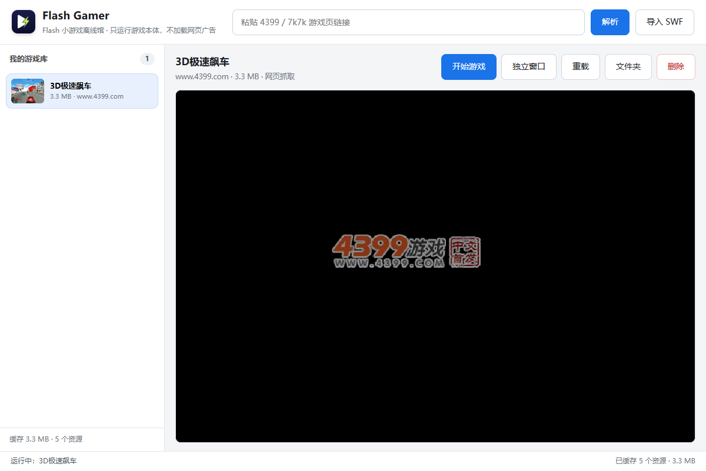
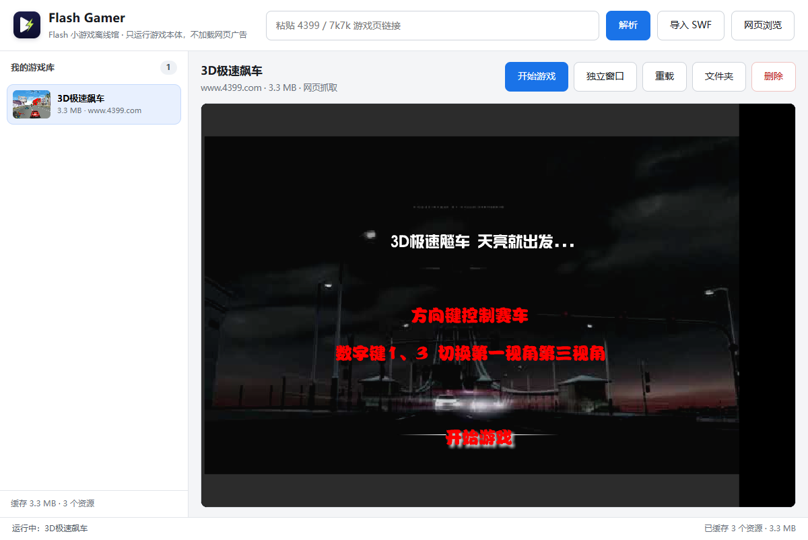
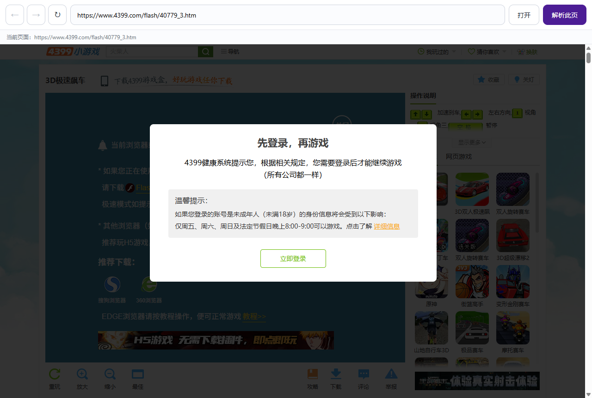

# Flash Gamer 实现复现手册（v0.2 / v0.3-dev）

本文按“需求 → 结论 → 实现 → 复现命令 → 验证证据 → 限制”的顺序记录本项目的全部改动。  
目标读者是拿到源码后想把每一处行为重新做出来、或想定位某个游戏为什么不能玩的人。

---

## 1. 需求清单与验收标准

| 编号 | 需求（用户原话） | 验收标准 |
| --- | --- | --- |
| R1 | 应用名改成 Flash Gamer | 窗口标题、程序名、安装包名、开始菜单名、数据目录名均为 Flash Gamer |
| R2 | 重新设计 logo | 新图标出现在 exe、窗口、主界面左上角；旧 AP 图标不再出现 |
| R3 | 加入网页功能，有的游戏要网页在线登录，有的网站要在线浏览 | 独立浏览器窗口可打开任意 http/https 页面；登录后 Cookie 能被游戏请求复用 |
| R4 | 4399 还是有部分加入库失效 | 给出的两个失败案例：40779 能解析并游玩；205551 的 `allowScriptAccess` 报错消失 |
| R5 | 后台运行游戏不被其他操作打断 | 游戏可开在独立窗口，主窗口继续解析/浏览，游戏不降频、不暂停 |
| R6 | 大量游戏同时加载出来两个文件但是一个都没用，做个问题确定一下 | 找出“两个候选都无效”的根因并修掉；重复解析不再产生重复条目 |
| R7 | 新版本放 dev 分支，没有浏览器功能的放本分支，不覆盖旧版/第一版 | `main`=v0.2 无浏览器；`dev`=v0.3 带浏览器；v0.1 产物原样保留 |
| R8 | 不行的功能就用 REA 逆向 | 对 4399 加载壳做二进制字符串提取、网络抓包与 Ruffle 内部行为验证 |
| R9 | 把需求和所有功能具体实现思路复现 | 本文档 |
| R10 | 完成之后关机 | 全部产物验证完毕后执行关机 |

---

## 2. 版本与分支

```
main    e2208c6  Flash Gamer v0.2.0（无浏览器）
dev     a097e04  Flash Gamer v0.3.0-dev（浏览器 + 登录共享）
v0.1.0  c773483  App Professor v0.1.0（只读归档）
```

- v0.1 的源码快照取自 `release/AppProfessor/resources/app`，单独提交在 `v0.1-app-professor` 分支并打 `v0.1.0` 标签。
- **v0.1 的任何运行产物都没有被覆盖**：
  - `release/AppProfessor/`
  - `release/AppProfessor-0.1.0-portable.zip`（sha256 不变）
- v0.2/v0.3 的打包输出使用独立的临时目录（`release/build-0.2.0-dir`、`release/build-0.3.0-dev-dir`），最后整理成 `release/FlashGamer-0.2.0/`、`release/FlashGamer-0.3.0-dev/` 及对应 zip。

---

## 3. 总体架构

```
┌────────────────────────── Electron 主进程 (src/main.js) ──────────────────────────┐
│  窗口管理：主窗口 / 独立游戏窗口 / 浏览器窗口(dev)                                  │
│  解析流程：Inspector（隐藏窗口抓包）→ 候选排序 → 下载校验 → 入库                     │
│  网络层：onBeforeRequest(广告拦截/控制器重定向)                                     │
│          onBeforeSendHeaders(Referer/登录 Cookie)                                  │
│          onHeadersReceived(CORS，仅播放器上下文)                                    │
└───────────────┬───────────────────────────────────────────────────────────────────┘
                │ IPC (preload.js / browser-preload.js)
┌───────────────▼────────────┐    ┌──────────────────────────────────────────────┐
│ 渲染层 renderer/            │    │ 本地 HTTP 服务 127.0.0.1:PORT (src/lib/server.js) │
│  index.html  主界面         │    │  /            主界面（ap_session Cookie 鉴权）     │
│  player.html 播放页         │    │  /play/:id    播放页（Ruffle 启动参数注入）        │
│  browser.html 浏览窗口(dev) │    │  /m/:id/...   SWF 镜像代理 + 资源缓存             │
└────────────────────────────┘    │  /file/:id/   本地 SWF                            │
                                  │  /vendor/ruffle、/vendor/4399、/cover            │
                                  └──────────────────────────────────────────────┘
```

数据目录（便携版为 exe 同目录 `FlashGamerData/`）：

```
FlashGamerData/
  library.json            游戏条目（含 sha256、flashvars、referer、cookie）
  items/<id>/
    main.swf              游戏本体
    cover.jpg             封面
    cache/<sha1>          运行时抓到的附加资源（含 .meta.json）
  tmp/                    Inspector 临时下载目录
  config.json             端口
```

---

## 4. 逐项实现

### 4.1 改名（R1）与图标（R2）

改动点：

- `package.json`：`name=flash-gamer`、`version=0.2.0`、`build.appId=com.flashgamer.desktop`、`build.productName=Flash Gamer`、`portable.artifactName=FlashGamer-${version}-portable.exe`。
- `src/main.js`：`app.setName('Flash Gamer')`；窗口 `title`、`icon` 更新；便携版数据目录 `FlashGamerData`，首次运行若存在旧 `AppProfessorData` 且新目录无 `library.json`，用 `fs.cpSync` 迁移。
- `src/renderer/index.html`：标题、品牌名、``。
- `src/renderer/player.html`：`<title>Flash Gamer</title>`，加载后按游戏标题设置 `document.title`。
- `README.md` 重写。

图标生成（可复现）：

```bash
# 1) 生成 1024×1024 源图（本仓库直接使用 vibe_images/flash-gamer-icon_*.png）
# 2) 安装纯 JS 工具到临时目录，避免污染依赖
npm install --prefix .tmp-tools jimp png-to-ico
# 3) 缩放并打包 ICO（16/32/48/64/128/256 多尺寸，512 供界面用）
node .tmp-make-icon.js vibe_images/flash-gamer-icon_1793385242463_3d79eefa.png
# 产物：build/icon.ico、build/icons/icon-*.png、src/renderer/icon.png
```

`png-to-ico` 生成的是 PNG 负载 ICO（Vista+ 支持），electron-builder 直接接受。

### 4.2 独立游戏窗口与后台运行（R5）

两个问题需要一起解决：

1. **渲染节流**：Chromium 会把不可见/被遮挡窗口的定时器降到 1Hz，游戏会“像卡住”。
2. **窗口绑定**：游戏直接嵌在主窗口 iframe 里，主窗口重载/切页就会重新加载游戏。

实现：

```js
// src/main.js 启动最前面
app.commandLine.appendSwitch('disable-renderer-backgrounding');
app.commandLine.appendSwitch('disable-background-timer-throttling');
app.commandLine.appendSwitch('disable-backgrounding-occluded-windows');

// 所有游戏相关窗口
webPreferences: { backgroundThrottling: false }
```

```js
// openGameWindow(id)：单实例、同 session、加载 /play/:id
const win = new BrowserWindow({
  width: 1000, height: 760, backgroundColor: '#000000',
  title: item.title, icon: .../icon.png,
  webPreferences: { contextIsolation: true, sandbox: true, backgroundThrottling: false }
});
win.loadURL(`${srv.origin}/play/${id}`);
```

- 主窗口点「独立窗口」→ `window.api.openWindow(id)` → `library:openWindow` IPC。
- 同一个游戏重复点击只会聚焦已开的窗口（`gameWindows` Map 按 id 去重）。
- 独立窗口共享 `session.defaultSession`，所以 `/play` 的 `ap_session` Cookie 直接可用。
- 主窗口最小化、刷新、解析别的游戏都不影响游戏窗口；游戏窗口关闭时才 `gameWindows.delete(id)`。

### 4.3 4399 解析失败修复（R4 / R6）

#### 4.3.1 40779：声明的是 HTML 包装页

现象：`https://www.4399.com/flash/40779_3.htm` 解析出的唯一候选是 `cell.swf`（3,643 字节广告占位壳），保存后黑屏。

逆向过程：

1. 抓页面源码 → 页面声明的 SWF 地址是 `.../9/Pack_jifen3_https.htm`（GB2312 编码的 HTML 文件）；
2. 下载该 HTML → 里面是 `<object><param name="movie" value="main.swf">`；
3. 真正游戏是同级目录的 `main.swf`（3,474,287 字节）；
4. `cell.swf` 是 4399 统一的广告/占位嵌入文件，所有页面都会出现。

修复（`src/lib/inspector.js`）：

```js
function looksHtml(buf, contentType) { /* text/html 或 <!doctype/<html 开头 */ }
function swfRefsFromHtml(text, baseUrl) {
  // 从 src/value/movie/data/url/file 属性、引号字符串、绝对 URL 中提取 .swf
}
function isAdSwf(url) {
  return /(^|\.)4399\.com$/i.test(host) && /\/flash\/cell\.swf$/i.test(path);
}
```

- 候选入队时直接丢弃 `cell.swf`；
- 下载阶段发现内容是 HTML 时，不报错，改为解析出其中的 SWF 引用，用包装页的 URL 作为 Referer 再下一轮下载；
- 第二轮结果优先级设为 4（高于普通声明候选），并合并去重。

验证：候选只剩 `main.swf`，`via=wrapper`，进入游戏后显示标题页「3D极速飙车 天亮就出发…」。

#### 4.3.2 205551：加载壳要求 `allowScriptAccess` flashvar

现象：`https://www.4399.com/flash/205551_4.htm`（死神VS火影3.3，69 MB）能抓到 `main.swf`，但播放时黑屏并显示「• allowScriptAcc…」。

逆向过程（REA）：

1. 解压 SWF（CWS/zlib）后搜索字符串，找到壳内置语言表：
   ```xml
   <allowScriptAccess en="Permission of 'allowScriptAccess' is required."
                       zh-CN="本文件要求allowScriptAccess权限"/>
   ```
2. 同一段 ABC 常量池里有壳的参数表：
   ```
   params: { allowScriptAccess: "always", allowNetworking: "all", recParams: { allowFullScreen: true } }
   com.sh.m_sh_manager / com.green.net.text_bin_loader / swf_loader / BleachVSNaruto_3_3
   ```
   说明壳读取的是 **`loaderInfo.parameters`（flashvars）**，而不是 `<param name="allowScriptAccess">` 嵌入属性。
3. Ruffle 的 `allowScriptAccess` 配置只影响 `ExternalInterface.available()`，不会写入 `loaderInfo.parameters`。
4. 对比网络日志，壳还会请求：
   - `https://cdn.comment.4399pk.com/control/ctrl_mo_v5.swf`（4399 控制器）
   - `https://cdn.comment.4399pk.com/control/A4399dv_base.swf`
   - `https://stat.api.4399.com/flash_ctrl_version.xml`、`flash_ad_version.xml`
   这些被广告域名黑名单全部拦掉，壳停在加载阶段。

修复：

```js
// src/lib/server.js
const DEFAULT_FLASHVARS = {
  allowScriptAccess: 'always',
  allowNetworking: 'all',
  allowFullScreen: 'true'
};
function mergeFlashvars(item) { return { ...DEFAULT_FLASHVARS, ...(item.flashvars || {}) }; }
// buildBoot 的两个分支都改为 parameters: mergeFlashvars(item)
```

```js
// src/lib/blocklist.js：按 URL 放行加载器必需资源，域名仍保持黑名单
const PRELOADER_ALLOW = [
  /^https?:\/\/cdn\.comment\.4399pk\.com\/control\/[\w.-]+\.swf$/i,
  /^https?:\/\/cdn\.comment\.4399pk\.com\/control\/zwsf2-3\.gif$/i,
  /^https?:\/\/stat\.api\.4399\.com\/flash_(?:ctrl|ad)_version\.xml$/i
];
```

```js
// src/main.js：把 ctrl_mo_v5.swf 重定向到本地副本，避开 4399 CDN 的防盗链
if (u.hostname === 'cdn.comment.4399pk.com' && /\/control\/ctrl_mo_v5\.swf$/i.test(u.pathname)) {
  return callback({ redirectURL: `http://127.0.0.1:${srv.port}/vendor/4399/ctrl_mo_v5.swf` });
}
```

`vendor/4399/ctrl_mo_v5.swf`（415,361 字节）随包分发；`/vendor/4399/*` 路由免 `ap_session` 鉴权并返回 `Access-Control-Allow-Origin: *`（Ruffle 以 fetch 方式拉取）。

结果与限制：

- 「allowScriptAccess」报错**消失**，壳推进到广告版本检测阶段；
- 进入游戏阶段后，Ruffle（0.7.1 与 0.8.0-nightly 均）输出：
  ```
  Encountered stub: AVM2 flash.display.Loader.load() addChild at the correct time
  ```
  画面停留在黑屏。这属于 Ruffle 对该壳 Loader 时序的未实现点，不是应用层能绕过的（详见第 7 节）。
- 复现验证：`AP_SMOKE=replay` 时 `iframe.allow=true`、无 allowScriptAccess 文本；Ruffle 日志无该报错。

#### 4.3.3 “两个文件但一个都没用”的判定（R6）

结论：不是队列并发 bug，而是**候选本身无效**：

- 候选 1：`cell.swf` —— 4399 广告占位壳，任何页面都会出现，体积小；
- 候选 2：声明地址实际是 `.htm` 包装页，下载后不是 SWF（旧逻辑保存失败或保存成一个“不能用”的文件）。

修复后：

- `cell.swf` 在候选阶段跳过；
- `.htm` 包装页自动跟进取真 SWF；
- 候选按 URL 去重（`seen` 集合），入库按 `sha256` 去重：重复解析/导入同一个 SWF 直接返回已有条目，不再产生第二份文件。

验证：对同一个链接连续解析两次，`library.json` 条目数保持 1。

### 4.4 网页浏览与登录（R3，dev 分支）

窗口结构：

- 独立 `BrowserWindow`，加载本地 `/browser`（`src/renderer/browser.html`）；
- 页面内 `<webview id="view">` 承载任意网站，`webviewTag: true` 仅对浏览器窗口开放；
- 工具栏：后退 / 前进 / 刷新 / 地址栏 / 打开 / 解析此页；
- 地址栏输入无协议时补 `https://`，非 URL 文本走 Bing 搜索；
- 默认打开 `https://www.4399.com/`，上次访问地址存 `localStorage`。

登录共享的两条路径：

1. **请求头注入**（`src/main.js` `onBeforeSendHeaders`，仅播放器上下文）：
   ```js
   const cks = await session.defaultSession.cookies.get({ url: details.url });
   if (cks.length) headers.Cookie = cks.map(c => `${c.name}=${c.value}`).join('; ');
   ```
   Ruffle 的 fetch 从 `127.0.0.1` 页面发往游戏 CDN 时，原本不会带第三方 Cookie；这里按目标 URL 从会话 Cookie 罐取值补上。
2. **服务端代理注入**（`src/lib/server.js` `cookieProvider`）：
   ```js
   // 代理 /m/ 与 CONNECT 转发时，优先用当前会话 Cookie，否则回退到条目里解析时保存的 Cookie
   const cookie = await resolveCookie(targetUrl, item);
   ```
   这样即使资源走本地 HTTP 代理，也能带上登录态。

上下文隔离：

- `isPlayerContext(details)` 只对主窗口（含播放 iframe）与独立游戏窗口生效；
- Referer/Cookie/CORS 注入都加了这个判断，浏览窗口的普通网页不会被塞入游戏的 Referer，也不会被强行加 CORS 头。

“解析此页”：

```js
// 浏览器窗口 IPC
const res = await inspectPage({ pageUrl, tmpDir: TMP_DIR, onProgress });
const item = await buildItemFromCandidate({ session: res, candidate: res.candidates[0] });
mainWindow.webContents.send('library:changed');   // 主窗口刷新列表
```

验证截图：浏览器窗口打开 4399 的 40779 页面，弹出「先登录，再游戏」登录框；点「解析此页」后提示「已加入游戏库：3D极速飙车（3.3 MB，共 1 个候选）」。

### 4.5 Ruffle 升级

- 版本：`0.8.0-nightly.2026.10.29`（npm dist-tag `nightly`）。
- `scripts/vendor-ruffle.js` 会把 `node_modules/@ruffle-rs/ruffle` 下的 `ruffle.js` 与 `*.wasm` 复制到 `vendor/ruffle`；新版是自包含布局（`ruffle_web_bg.*.wasm`、`ruffle_web-wasm_mvp_bg.*.wasm`），旧的 `core.ruffle.*` 文件需要先清理。
- 打包 `files` 从 `vendor/ruffle/**/*` 改为 `vendor/**/*`，确保 `vendor/4399` 一起进包。

---

## 5. 从零复现

### 5.1 环境

- Windows 10/11 x64，Node.js ≥ 20（本机 v24.18.0）
- 网络可访问 npm 与 4399；无 GitHub 依赖（Ruffle 走 npm）
- Git Bash 下注意：如果设置了 `ELECTRON_RUN_AS_NODE=1`，启动 Electron 前必须 `unset ELECTRON_RUN_AS_NODE NODE_OPTIONS`

### 5.2 构建

```bash
git clone <repo> flash-gamer && cd flash-gamer
git checkout main          # 或 dev
npm install                # postinstall 自动 vendor Ruffle
npm start                  # 开发模式，数据写 ./data
```

### 5.3 打包（两个版本互不影响）

直接运行 `npm run dist`（electron-builder portable）时，本机在解压 Electron 后会把 `win-unpacked.tmp` 整体改名为 `win-unpacked`；Windows Defender/索引服务会短暂占用 `resources/default_app.asar`，导致改名 `EPERM`、回退删除又 `EBUSY`。因此本机改用“已解压 Electron + 复制”的路径：先解一次官方 zip，再用 `electronDist` 指向它（electron-builder 会走 `copyDir` 而不是改名），目标用 `--dir` 出绿色目录。

```bash
# 0) 本机准备一次：把 Electron 45.1.0 官方 zip 解到本地
ELECTRON_ZIP=$(ls "$LOCALAPPDATA"/electron/Cache/*/electron-v45.1.0-win32-x64.zip | head -1)
"$LOCALAPPDATA/electron-builder/Cache/7zip@1.0.0/7zip-win-x64-1nrf7/bin/7za.exe" \
  x -y "$ELECTRON_ZIP" -o release/electron-dist-45.1.0

# 1) v0.2（main，无浏览器）
git checkout main
unset ELECTRON_RUN_AS_NODE NODE_OPTIONS
npx electron-builder --dir --win --x64 \
  --config.directories.output=release/build-0.2.0-dir \
  --config.electronDist=release/electron-dist-45.1.0

# 2) v0.3（dev，浏览器）
git checkout dev
npx electron-builder --dir --win --x64 \
  --config.directories.output=release/build-0.3.0-dev-dir \
  --config.electronDist=release/electron-dist-45.1.0
```

产物整理（`default_app.asar` 在运行测试时可能被系统占用而删不掉，直接排除；它只是 Electron 的兜底 app，存在 `app.asar` 时不会加载）：

```bash
robocopy "release\build-0.2.0-dir\win-unpacked" "release\FlashGamer-0.2.0" /E /XF default_app.asar
robocopy "release\build-0.3.0-dev-dir\win-unpacked" "release\FlashGamer-0.3.0-dev" /E /XF default_app.asar
7za a -tzip -mx=5 release/FlashGamer-0.2.0-portable.zip release/FlashGamer-0.2.0
7za a -tzip -mx=5 release/FlashGamer-0.3.0-dev-portable.zip release/FlashGamer-0.3.0-dev
7za t release/FlashGamer-0.2.0-portable.zip
7za t release/FlashGamer-0.3.0-dev-portable.zip
```

> `package.json` 的 `npm run dist` 仍是标准单文件 portable 目标；在没有文件占用的机器上可直接用。本次交付采用绿色目录 + zip，避免依赖 NSIS 自解压层。

### 5.4 自动化验收（无头/离屏）

主进程内置 smoke 模式，环境变量：

| 变量 | 作用 |
| --- | --- |
| `AP_DATA_DIR` | 指定临时数据目录，避免污染真实游戏库 |
| `AP_SMOKE=full` + `AP_SMOKE_URL` | 完整走一遍“解析→入库→播放” |
| `AP_SMOKE=replay` + `AP_SMOKE_ITEM` | 直接回放已入库的游戏 |
| `AP_SMOKE_WAIT` | 播放等待毫秒数 |
| `AP_SMOKE_CLICK=1` | 点击一次舞台中央（越过标题页/开始按钮） |
| `AP_SMOKE_OFFSCREEN=1` | 窗口使用离屏渲染，`capturePage()` 在无桌面会话下也能出图 |
| `AP_SMOKE_WINDOW=1` | 额外验证独立游戏窗口（标题、URL、Ruffle 元数据） |
| `AP_SMOKE_BROWSER=1` | 打开浏览器窗口并导航到 4399 |
| `AP_SMOKE_BROWSER_PARSE=1` | 在浏览器窗口点“解析此页”，校验入库结果 |

示例（40779 全流程）：

```bash
unset ELECTRON_RUN_AS_NODE NODE_OPTIONS
AP_DATA_DIR="$PWD/.tmp-smoke-40779" \
AP_SMOKE=full \
AP_SMOKE_URL="https://www.4399.com/flash/40779_3.htm" \
AP_SMOKE_WAIT=12000 AP_SMOKE_CLICK=1 AP_SMOKE_OFFSCREEN=1 \
./node_modules/electron/dist/electron.exe .
```

---

## 6. 验收矩阵（本机实测）

| 项目 | 版本 | 方法 | 结果 |
| --- | --- | --- | --- |
| 40779 解析（源码） | v0.2/v0.3 | 全流程 smoke | 通过：候选 1 个，`main.swf` 3,474,287 B，`via=wrapper` |
| 40779 游玩（源码） | v0.2/v0.3 | `AP_SMOKE_CLICK=1` 截图 | 通过：进入「3D极速飙车」标题页 |
| 40779 解析（打包 exe） | v0.2 | `release/FlashGamer-0.2.0/Flash Gamer.exe` | 通过：同一候选、同一标题，写入 3,474,938 B 缓存 |
| 40779 游玩（打包 exe） | v0.2/v0.3 | 打包版 replay + 截图 | 通过：640×480、15 fps；`docs/FlashGamer-v0.2-40779.png`、`docs/FlashGamer-v0.3-40779.png` |
| 205551 解析（打包 exe） | v0.2 | 打包版 full smoke | 通过：`main.swf` 69,072,554 B（65.9 MB），800×600、30 fps |
| 205551 allowScriptAccess 报错 | v0.2/v0.3 | 回放 smoke + Ruffle 日志 | 通过：报错消失 |
| 205551 进入游戏 | — | 打包版回放 | 未通过：Ruffle stub `Loader.load() addChild at the correct time`，黑屏 |
| 独立游戏窗口（打包 exe） | v0.2/v0.3 | `AP_SMOKE_WINDOW=1` | 通过：标题「3D极速飙车 — Flash Gamer」、URL `/play/:id`、Ruffle 元数据 640×480 |
| 后台运行（实测） | v0.3（打包 exe） | CDP 在游戏页计 rAF，浏览器窗口置前 5 秒 | 通过：rAF 392 → 859（+467 帧），游戏窗口 `hasFocus()=false`，画面循环未停 |
| 浏览器窗口（打包 exe） | v0.3 | `AP_SMOKE_BROWSER=1` + 截图 | 通过：4399 页面正常渲染，登录弹窗正常（`docs/FlashGamer-v0.3-browser-login.png`） |
| 浏览器解析入库（打包 exe） | v0.3 | `AP_SMOKE_BROWSER_PARSE=1` | 通过：提示「已加入游戏库：3D极速飙车（3.3 MB，共 1 个候选）」，library 条目 +1 |
| 去重 | v0.2/v0.3 | 重复解析两次 | 通过：条目数不增 |
| exe 图标与版本信息 | v0.2/v0.3 | `ExtractAssociatedIcon` + `VersionInfo` | 通过：`ProductName=Flash Gamer`，版本 0.2.0.0 / 0.3.0.0，图标为新 logo |
| zip 完整性 | v0.2/v0.3 | `7za t` | 通过：两个 zip 均 `Everything is Ok` |
| v0.1 产物保留 | — | 目录与校验和检查 | 通过：`release/AppProfessor*` 未改动，zip sha256 未变 |

> 说明：无桌面会话时 `capturePage()` 可能返回 `UnknownVizError` 或旧帧；`AP_SMOKE_OFFSCREEN=1` 是可靠的截图方式。

截图证据：

- 打包版 v0.2 运行 40779：`docs/FlashGamer-v0.2-40779.png`
- 打包版 v0.3 运行 40779：`docs/FlashGamer-v0.3-40779.png`
- 打包版 v0.3 浏览器与 4399 登录弹窗：`docs/FlashGamer-v0.3-browser-login.png`







---

## 7. 已知限制

1. **205551 类加载壳**：Ruffle 对 `flash.display.Loader.load()` 的“按时 addChild”仍是 stub，壳停在黑屏。两个 Ruffle 版本均复现，说明是模拟器能力问题，不是参数问题。可选路线：等 Ruffle 实现该语义；或在 dev 分支接浏览器 + 4399 网页自身（需要真实 Flash 插件，Chromium 已移除，不可行）；或对壳做二进制 patch（需 FFDec/JPEXS 与 Java，未在本机安装）。
2. **AS3 兼容性**：Ruffle 对复杂 AS3/Flex 项目覆盖有限，部分游戏能加载但交互异常。
3. **登录态范围**：Cookie 注入解决了“游戏请求带登录 Cookie”，但有些 4399 接口还要求页面里的 JS 桥（`4399api_*` 回调）。本机用 `Reflect.get` 钩子监听 30 秒未发现壳发起 JS 调用，故未实现桥接；如后续发现调用，可在 `player.html` 里按名称补 `window['4399api_xxx']`。
4. **HTTPS 证书**：主进程 `onHeadersReceived` 只为播放器上下文补 CORS，不忽略证书错误；某些老站点自签证书会直接失败。
5. **广告拦截**：域名级黑名单可能误伤同域下的必要接口，遇到“加载卡住”可先用 `AP_OFFLINE` 之外的正常网络复测，并把必要路径加入 `PRELOADER_ALLOW`。
6. **7k7k**：解析路径与 4399 共用 Inspector，但 7k7k 的播放器壳未做专门适配；本机仅验证了页面解析，未逐游戏验证。

---

## 8. 排障速查

| 症状 | 先看 | 处理 |
| --- | --- | --- |
| 解析出 0 个候选 | 页面是否 H5；是否要手动点“开始游戏” | 用 dev 浏览器窗口打开并点开始后再“解析此页” |
| 候选是 3 KB 左右 | 是否 `cell.swf` | 已被过滤；若仍有，把 URL 加进 `isAdSwf` 规则 |
| 保存后黑屏 | Ruffle 控制台错误 | 开 `localStorage.apDebug=1` 看 `stub` / `FetchError` |
| 4399 资源 403 | Referer/Cookie | 检查 `isPlayerContext` 与 `resolveCookie` 是否命中 |
| 浏览器窗口白屏 | CSP / webview | 确认窗口 `webviewTag:true`，且 `/browser` 路由返回 200 |
| 游戏在主窗口卡顿 | 是否用了独立窗口 | 用「独立窗口」启动，主窗口的重活不会影响它 |
| 打包报 `EPERM/EBUSY ... default_app.asar` | electron-builder 解压改名阶段被系统占用 | 不解压：`--config.electronDist=<已解压 Electron 目录>` + `--dir`，见 5.3 |

---

## 9. 产物清单

| 路径 | 说明 | 大小 |
| --- | --- | --- |
| `release/AppProfessor/`、`release/AppProfessor-0.1.0-portable.zip` | v0.1，未改动 | 557 MB / 164,168,872 B |
| `release/FlashGamer-0.2.0/` | v0.2 绿色版目录（无浏览器） | 415 MB |
| `release/FlashGamer-0.2.0-portable.zip` | v0.2 压缩包 | 174,562,696 B |
| `release/FlashGamer-0.3.0-dev/` | v0.3 绿色版目录（含网页浏览） | 415 MB |
| `release/FlashGamer-0.3.0-dev-portable.zip` | v0.3 压缩包 | 174,564,267 B |
| `build/icon.ico`、`build/icons/` | 新图标 | — |
| `vendor/ruffle/` | Ruffle 0.8.0-nightly.2026.10.29 | — |
| `vendor/4399/ctrl_mo_v5.swf` | 4399 控制器离线副本 | 415,361 B |

校验值（本机生成，供比对）：

```
a51d94d6b9e4880c4a80974778d54d7ec704b2c878904895ecfdf1e715a86651  FlashGamer-0.2.0-portable.zip
6c3da4019055bd67848e0c1e740552eda734f769dd1b52cf67a7e3852391ccd9  FlashGamer-0.3.0-dev-portable.zip
dc40d2f2c212f4fd3785eeb352e7a1eab6781436c42bc90103d988883785800f  AppProfessor-0.1.0-portable.zip
```

```bash
sha256sum release/FlashGamer-0.2.0-portable.zip release/FlashGamer-0.3.0-dev-portable.zip
```
